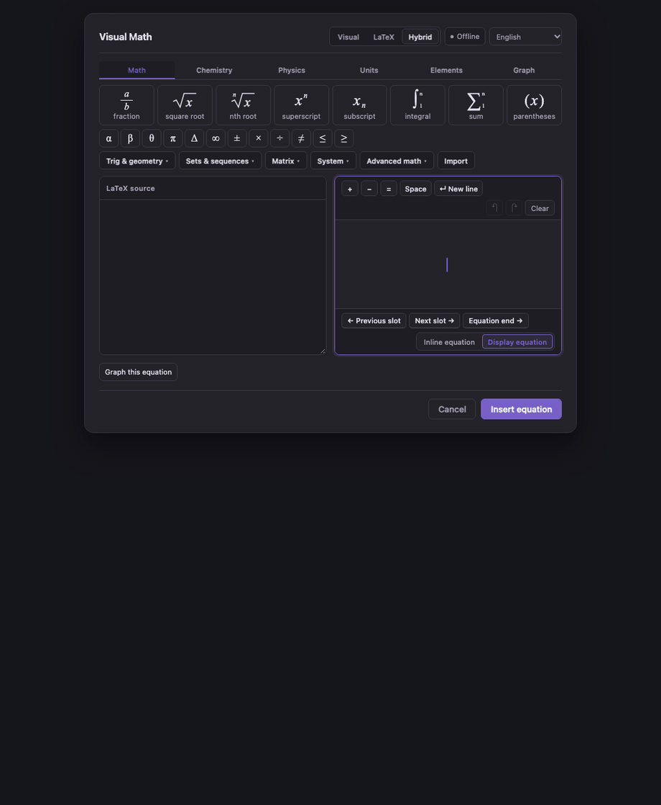
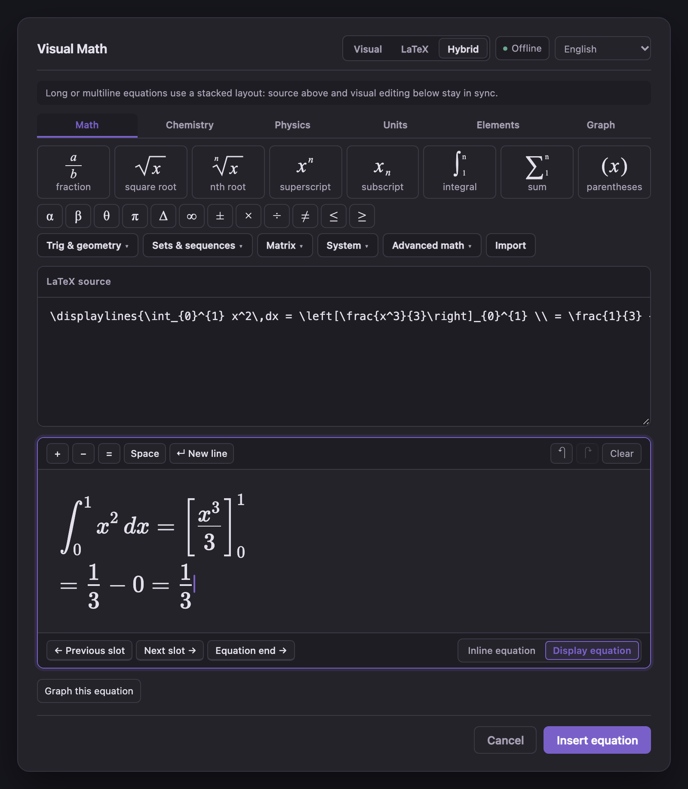
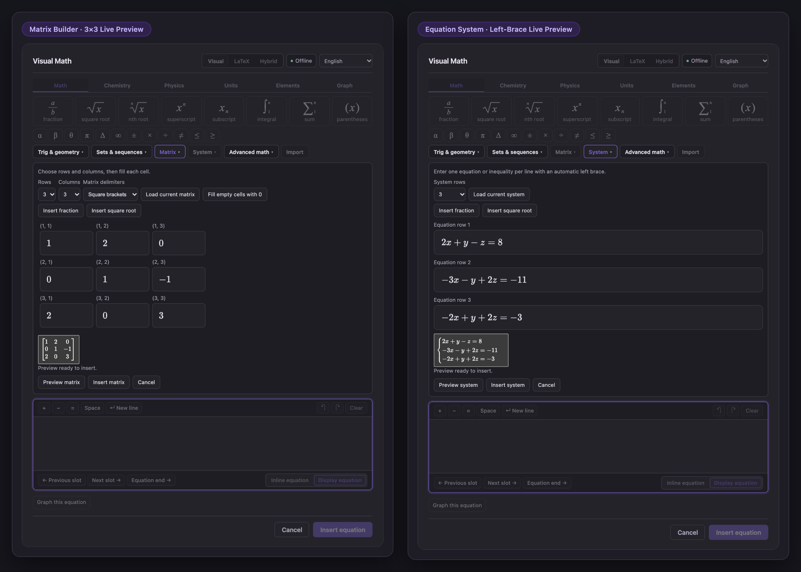
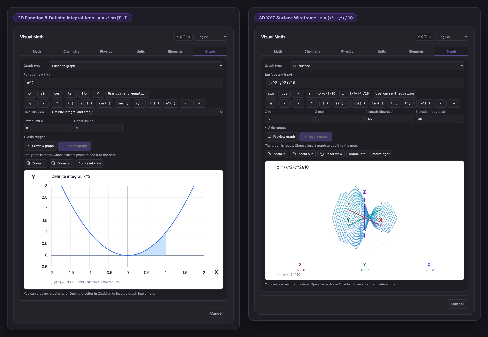
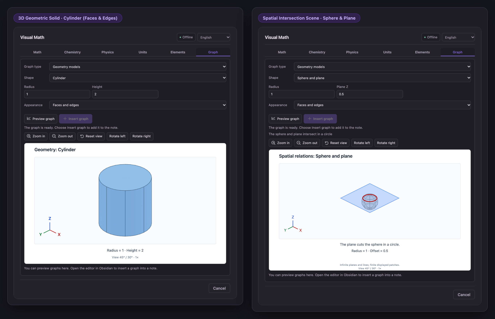
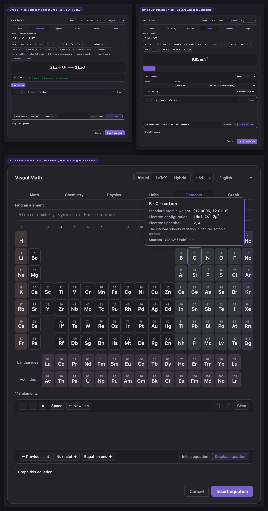

# Visual Math für Obsidian

[English](README.md) · [简体中文](README.zh-CN.md) · [Español](README.es.md) · [日本語](README.ja.md) · **Deutsch** · [Français](README.fr.md)

**[In Obsidian installieren](https://community.obsidian.md/plugins/visual-math-editor)** · **[Offizielle Website](https://oranipost.github.io/visual-math/)** · **[YouTube-Tutorials](https://www.youtube.com/@VisualMathForObsidian)** · **[1.1.2 ZIP herunterladen](https://github.com/oranipost/visual-math-editor/releases/download/1.1.2/visual-math-editor-1.1.2.zip)** · **[Versionshinweise](https://github.com/oranipost/visual-math-editor/releases/tag/1.1.2)**

## Überblick

Ich habe **Visual Math** entwickelt, damit man Mathematik-, Chemie- und Physiknotizen in Obsidian schreiben kann, ohne jedes Mal rohen LaTeX-Code von Hand eintippen zu müssen.

Wenn du den Editor in einer Notiz öffnest, kannst du Brüche, Wurzeln, Integrale, Summen, Matrizen oder Gleichungssysteme direkt anklicken und die Platzhalterfelder ausfüllen. Wenn du bereits mit LaTeX vertraut bist, wechsle in den **LaTeX**- oder **Hybrid**-Modus, um Quellcode und gerenderte Formel nebeneinander zu bearbeiten. Mit `↵ Neue Zeile` (`Shift+Enter`) fügst du jederzeit weitere Zeilen innerhalb desselben Formelblocks hinzu.

Alles wird als normales `$…$`- oder `$$…$$`-Markdown in deiner Notiz gespeichert. Sämtliche Schriften, Einheitentabellen und Grafikwerkzeuge laufen zu 100 % lokal und offline – ohne KI, ohne Cloud-Konto und ohne kostenpflichtiges Abo.

- **Website & Funktionsübersicht**: [oranipost.github.io/visual-math](https://oranipost.github.io/visual-math/)
- **Video-Anleitungen**: [@VisualMathForObsidian auf YouTube](https://www.youtube.com/@VisualMathForObsidian)



---

## Funktionsumfang

- **Visuelle, LaTeX- und Hybrid-Bearbeitung**: Bearbeite Formeln über visuelle Platzhalter, direkten TeX-Quelltext oder beides gleichzeitig – inklusive mehrzeiliger Formeln (`↵ Neue Zeile`), Rückgängig/Wiederholen-Verlauf und Einzelformel-Import.
- **Matrizen, Gleichungssysteme, griechische Buchstaben, Mengen & Analysis**: Erstelle `1×1`- bis `6×6`-Matrizen, Gleichungssysteme mit `2–6` Zeilen und geschweifter Klammer links, alle 41 griechischen Buchstaben (`α–ω`, Varianten und Großbuchstaben), 19 Mengen- und Folgensymbole, Trigonometrie-/Geometrienotation sowie 9 Analysis- und Vektorvorlagen.
- **Funktions-, Polar-, 3D-Flächen- & komplexe Graphen**: Zeichne `y = f(x)` (mit numerischer 1./2. Ableitung und bestimmtem Integral), Polarkurven `r = f(θ)`, 3D-Flächen `z = f(x, y)` und komplexe Punkte (`Re / Im`) direkt unter deiner Formel oder kopiere jeden Graphen mit einem Klick als PNG-Bild.
- **3D-Geometrie & zusammengesetzte Körper**: Drehe und zoome 9 geometrische Grundkörper (Kugel, Halbkugel, Zylinder, Kegel, Kegel-/Pyramidenstumpf, regelmäßige Pyramide, regelmäßiges Prisma, Quader, Ebene), kombiniere `2–6` Teilkörper zu zusammengesetzten 3D-Figuren (mit Aufgabenvorlagen, Versatz/Rotation und Massiv-/Transparent-/Drahtgitterstil) und untersuche 3 räumliche Schnittmodelle (zwei Ebenen, Gerade und Ebene, Kugel und Ebene).
- **Chemie, Physik, Einheiten & 10-Kategorien-Periodensystem**: Schreibe chemische Reaktionsgleichungen (`\ce`) mit Ausgleichsprüfung, nutze 24 Physikvorlagen, rechne 66 Einheiten aus 11 Kategorien offline um (`\pu`, inkl. `eV`, `keV`, `MeV`) und schlage alle 118 Elemente in 10 chemischen Elementfamilien samt Schnellleiste für Reaktionsgleichungen (`→`, `⇌`, `Δ`, `↑`, `↓`, Indizes, Ladungen und Zustände) nach.
- **100 % lokal offline & 6-sprachig**: Funktioniert komplett ohne Internetverbindung, ohne KI und ohne externe Konten. Verfügbar auf **Deutsch**, **English**, **简体中文**, **Español**, **日本語** und **Français**.

---

## Schnellstart

1. **Editor öffnen**: Setze den Cursor in eine Notiz und klicke oben oder in der linken Seitenleiste auf **∑** (oder führe `Visual Math: Formel einfügen oder bearbeiten` über die Befehlspalette aus).
2. **Struktur ausfüllen**: Klicke im **Visuell**-Modus auf **Bruch**, tippe `3`, drücke `Tab` und tippe `4`. Über die kompakte Zweitleiste (`αβ Griechische Buchstaben`, `Trig. & Geometrie`, `Mengen & Folgen`, `Matrix`, `System`, `Höhere Mathematik`, `Import`) öffnest du bei Bedarf weitere Werkzeuge.
3. **Speichern oder zeichnen**: Wähle unten rechts **Formel im Text** (`$…$`) oder **Eigene Zeile** (`$$…$$`) und klicke auf **Formel einfügen** (`Ctrl/Cmd + Enter`) – oder klicke auf **Diese Formel zeichnen**, um den Graphen direkt unter dem Editor darzustellen.

---

## Installation

### Über die Obsidian Community-Plugins

1. Öffne **[Visual Math im Obsidian-Plugin-Verzeichnis](https://community.obsidian.md/plugins/visual-math-editor)** und klicke auf **Add to Obsidian**.
2. Klicke in Obsidian auf **Install** und anschließend auf **Enable**.
3. Öffne eine beliebige Markdown-Notiz und klicke auf **∑**.

### Manuelle ZIP-Installation (Desktop-Version 1.1.2)

Lade **[visual-math-editor-1.1.2.zip](https://github.com/oranipost/visual-math-editor/releases/download/1.1.2/visual-math-editor-1.1.2.zip)** herunter (kompiliertes Release-Archiv; bitte nicht das *Source code*-Archiv von GitHub herunterladen):

1. Entpacke den Ordner `visual-math-editor` nach `<dein-vault>/.obsidian/plugins/`.
2. Prüfe, dass `main.js`, `manifest.json`, `styles.css` und die Lizenzdateien direkt in `.obsidian/plugins/visual-math-editor/` liegen.
3. Starte Obsidian neu und aktiviere **Visual Math** unter **Einstellungen → Community-Plugins**.

Ausführliche Hinweise findest du in der [Installations- und Aktualisierungsanleitung](docs/INSTALLATION.md).

---

## Screenshots (v1.1.2)

### Hybrid-Modus, mehrzeilige Formeln & kompakte Werkzeugleiste


### Visuelle Matrizen & Gleichungssysteme


### 2D-Funktionsanalysis & 3D-XYZ-Flächen


### Geometrische 3D-Körper & räumliche Lagebeziehungen


### Reaktionsausgleich, Einheitenrechner & Periodensystem


---

<details>
<summary><strong>Technischer Rahmen, Grenzen & lokaler Build (Zum Aufklappen klicken)</strong></summary>

### Umfang & Grenzen

- **Notation und numerische Graphen**: Visual Math formatiert mathematische und naturwissenschaftliche Notation und zeichnet numerische Graphen sowie anschauliche Geometrieszenen. Es löst keine Gleichungen symbolisch, berechnet keine Matrizenoperationen, sortiert keine Mengen und beweist keine Sätze.
- **Einzelformel-Import**: Akzeptiert reines LaTeX oder genau ein äußeres Begrenzerpaar (`$…$`, `$$…$$`, `\(...\)`, `\[...\]`) mit bis zu **8.192 Zeichen**. Bis **4.096 Zeichen** wird eine visuelle Live-Vorschau gerendert; gültige Formeln zwischen 4.097 und 8.192 Zeichen behalten ihren vollständigen Quelltext zur Bearbeitung im LaTeX- oder Hybrid-Modus.
- **Matrizen und Gleichungssysteme**: `1–6` Zeilen/Spalten für Matrizen und `2–6` einspaltige Zeilen für Gleichungssysteme (`cases`). Leere Matrixzellen lassen sich per Klick mit `0` füllen; beim Ändern der Größe bleiben ausgeblendete Zellen während der Sitzung erhalten.
- **Graphen und Geometrie**:
  - Explizite Funktionen `y = f(x)` (bis 500 Zeichen), Polarkurven `r = f(θ)` (`θ`-Bereich bis `100π`), numerische 1./2. Ableitung und bestimmte Integrale auf endlichen stetigen Intervallen, 3D-Drahtgitterflächen `z = f(x, y)` sowie bis zu 20 komplexe Punkte (`a + bi`, bis 1.000 Zeichen).
  - Nach dem Speichern sind Formelblöcke (`$…$` / `$$…$$`) und Grafikblöcke (`vme-plot`) getrennte Blöcke in der Notiz; verwende **Grafik bearbeiten** oder **Ansicht speichern**, um die gespeicherte Grafikansicht zu aktualisieren.
- **Naturwissenschaftliche Werkzeuge**: Chemie (`\ce{…}`) und Einheiten (`\pu{…}`) erfordern beim Export außerhalb von Obsidian eine `mhchem`-Unterstützung der Zielumgebung. Die Offline-Einheitenumrechnung umfasst 66 Einheiten in 11 Kategorien auf Basis fester Convert-8.0.2-Konstanten und der exakten SI-2019-Elektronenvolt-Definition; Elementdaten folgen den Referenzen von CIAAW und NIST.
- **Kompatibilität**: Erfordert **Obsidian 1.14.4+** auf dem Desktop. Prüfberichte befinden sich in [TEST-REPORT.md](TEST-REPORT.md) und [CHANGELOG.md](CHANGELOG.md).

### Aus dem Quellcode bauen

Erfordert Node.js 22 oder 24:

```sh
npm ci
npm run check
npm run package
```

Lokale Komponentenvorschau für die Entwicklung (bindet nur an `127.0.0.1:8471`):

```sh
npm run preview
```

Siehe [CONTRIBUTING.md](CONTRIBUTING.md), [RELEASING.md](RELEASING.md), [LANGUAGE-SUPPORT.md](LANGUAGE-SUPPORT.md) und [third-party-sources/README.md](third-party-sources/README.md).

</details>

---

## Datenschutz, Support & Lizenz

- **Offline & privat**: Keine Telemetrie, keine externen Schriften oder CDNs und keine Hintergrundüberwachung der Zwischenablage. Siehe [SECURITY.md](SECURITY.md).
- **Autor & Kontakt**: Entwickelt von [Oliver / oranipost](https://github.com/oranipost) ([oranipost@outlook.com](mailto:oranipost@outlook.com)). Fehlermeldungen oder Vorschläge gerne über [GitHub Issues](https://github.com/oranipost/visual-math-editor/issues).
- **Lizenz**: Ab Version 0.7.0 steht der Projektcode unter der [GNU GPL v3.0 only mit der Obsidian-Linking-Ausnahme](LICENSING.md) (Copyright © 2026 Dongfang Wang; älterer Code `≤ 0.6.5` behält seine ursprüngliche MIT-Lizenz). Hinweise zu eingebundenen Drittanbieter-Komponenten (MathLive, Convert, KaTeX-Schriften unter MIT sowie mhchem unter Apache 2.0) stehen in [THIRD-PARTY-NOTICES.md](THIRD-PARTY-NOTICES.md). Deine eigenen Notizen und Formeln unterliegen niemals der GPL.
