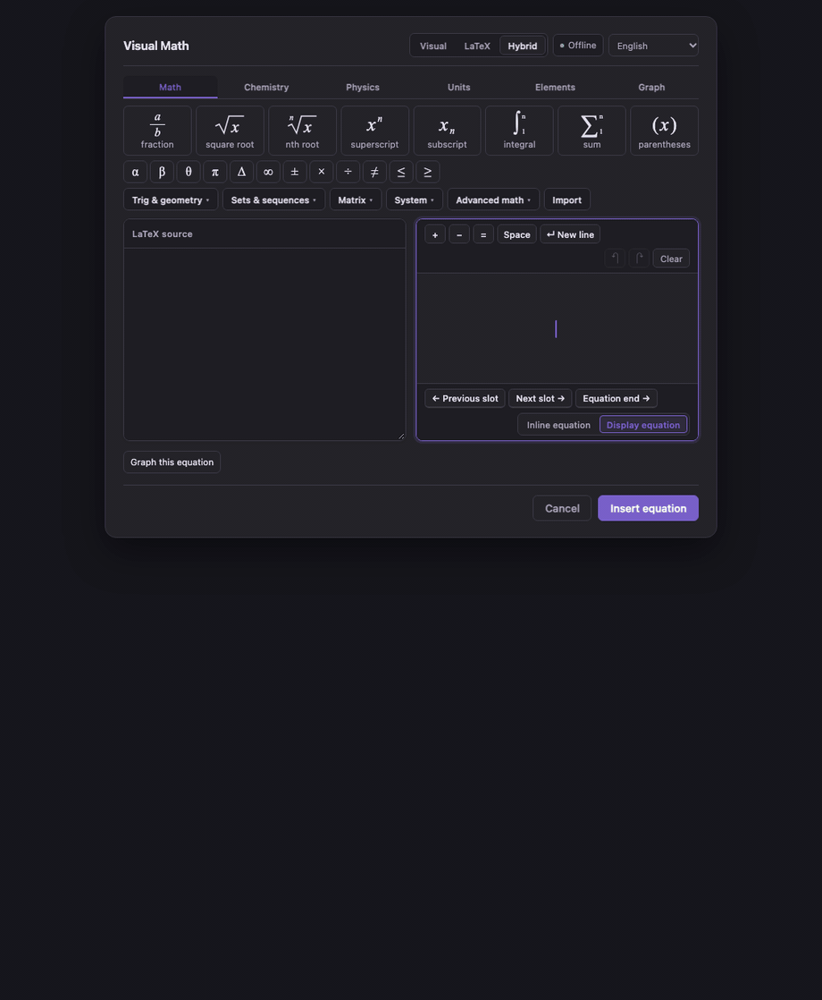
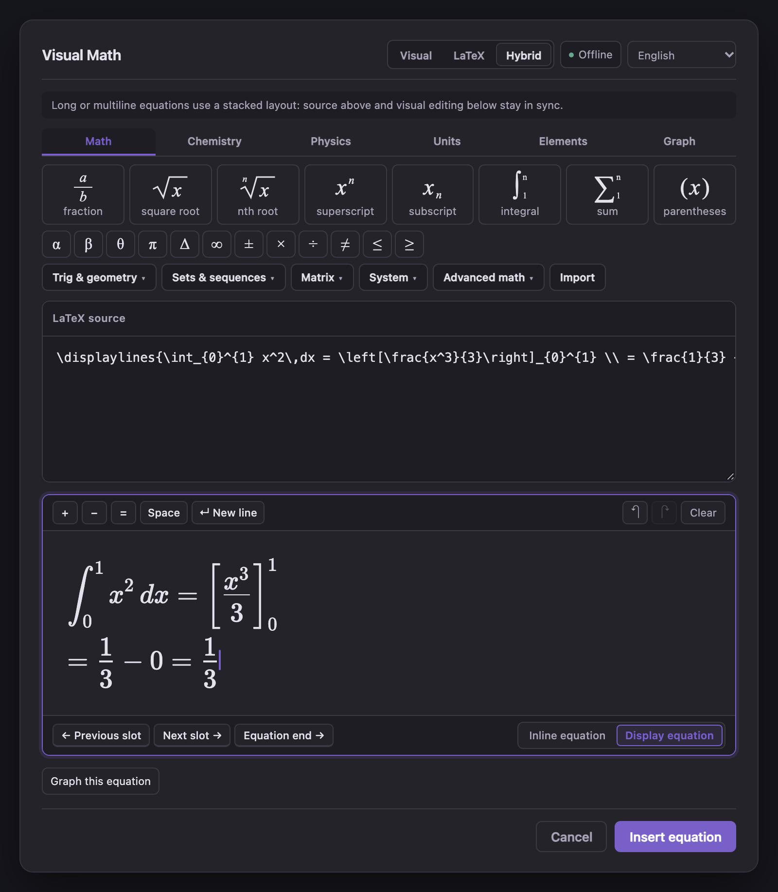
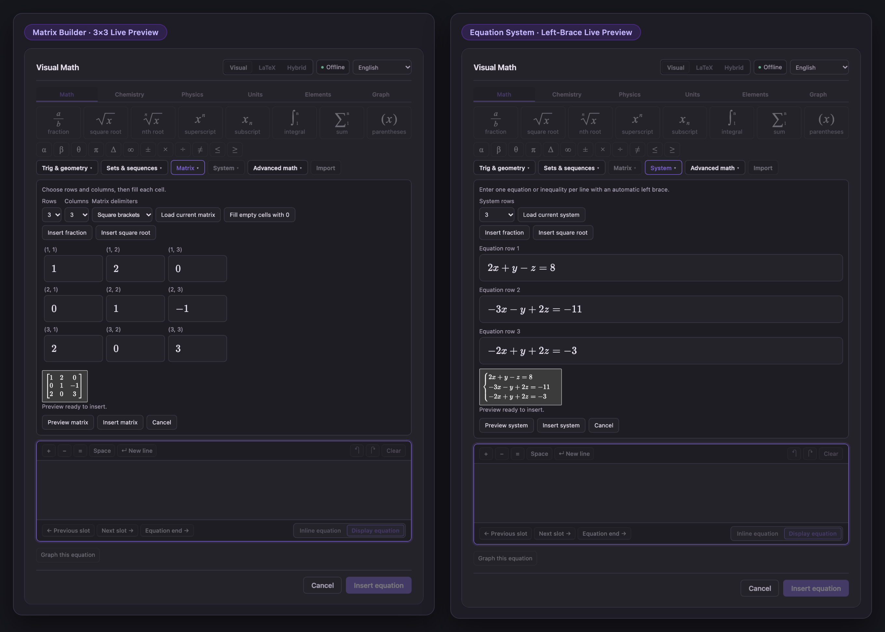
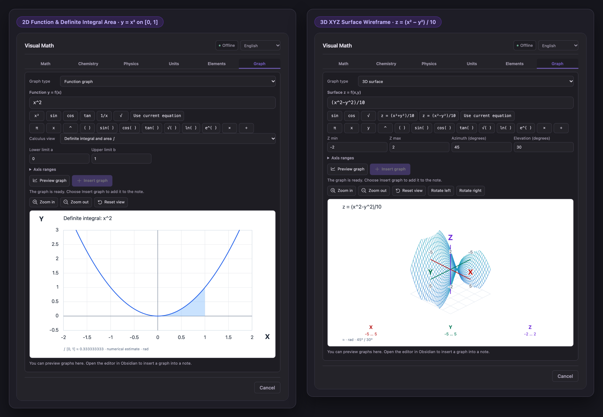
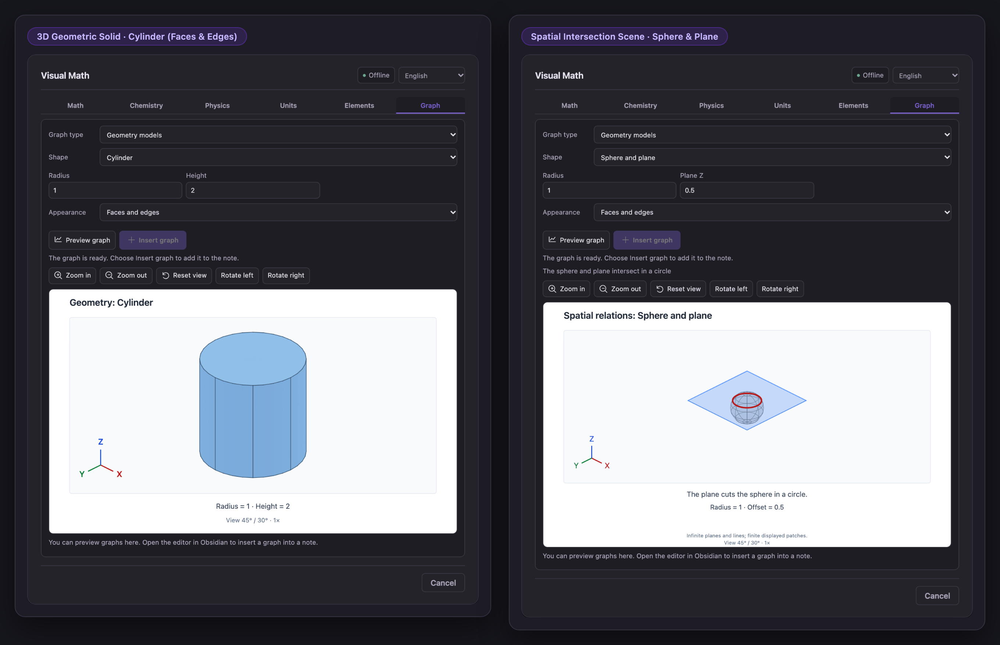
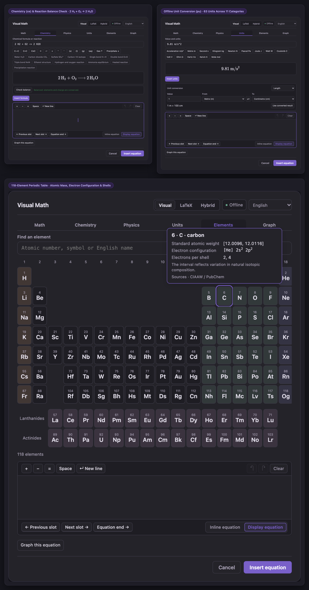

# Visual Math for Obsidian

**English** · [简体中文](README.zh-CN.md) · [Español](README.es.md)

**[Install in Obsidian](https://community.obsidian.md/plugins/visual-math-editor)** · **[Official Website](https://oranipost.github.io/visual-math/)** · **[YouTube Tutorials](https://www.youtube.com/@VisualMathForObsidian)** · **[Download 1.1.0 ZIP](https://github.com/oranipost/visual-math-editor/releases/download/1.1.0/visual-math-editor-1.1.0.zip)** · **[Release Notes](https://github.com/oranipost/visual-math-editor/releases/tag/1.1.0)**

## Overview

I built **Visual Math** so you can write math, chemistry, and physics notes in Obsidian without typing raw LaTeX by hand every time.

When you open the editor inside a note, you can click fractions, roots, integrals, sums, matrices, or equation systems and fill in the boxes directly. If you already know LaTeX, switch to **LaTeX** or **Hybrid** mode to edit the code and the rendered formula side by side. Press `↵ New line` (`Shift+Enter`) whenever you want multiple lines inside the same equation block.

Everything saves as standard `$…$` or `$$…$$` Markdown in your note, and all fonts, unit tables, and graphing tools run locally offline.

- **Website & Feature Guide**: [oranipost.github.io/visual-math](https://oranipost.github.io/visual-math/)
- **Video Walkthroughs**: [@VisualMathForObsidian on YouTube](https://www.youtube.com/@VisualMathForObsidian)



---

## What's Inside

- **Visual, LaTeX, and Hybrid editing**: Edit with visual placeholders, raw TeX source, or both at once. Includes multi-line equations (`↵ New line`), undo/redo history, and single-formula LaTeX import.
- **Matrices, systems, sets, and calculus notation**: Build `1×1` to `6×6` matrices, `2–6` row equation systems with a left brace, 19 set/sequence symbols, trig/geometry notation, and 9 calculus/vector templates.
- **Function, polar, 3D surface, and complex graphs**: Plot `y = f(x)` (with numerical 1st/2nd derivatives and definite integrals), polar curves `r = f(θ)`, 3D surfaces `z = f(x, y)`, and `Re / Im` complex points right below your equation.
- **3D geometry models**: Rotate and zoom 7 geometric solids (sphere, cylinder, cone, pyramid, prism, cuboid, plane) and 3 spatial intersection scenes (two planes, line–plane, sphere–plane).
- **Chemistry, physics, units, and periodic table**: Write chemical reactions (`\ce`) with balance checks, insert physics formulas, convert across 63 units in 11 categories (`\pu`), and look up all 118 elements.
- **Offline and trilingual**: Works without internet or external accounts. Available in **English**, **简体中文**, and **Español**.

---

## Quick Start

1. **Open the editor**: Place your cursor in a note and click **∑** in the note header or left ribbon (or run `Visual Math: Insert or edit equation` from the command palette).
2. **Fill in a structure**: In **Visual** mode, click **fraction**, type `3`, press `Tab`, and type `4`. Use the secondary tool bar (`Trig & geometry`, `Sets & sequences`, `Matrix`, `System`, `Advanced math`, `Import`) whenever you need larger structures.
3. **Save or plot**: Pick **Inline equation** (`$…$`) or **Display equation** (`$$…$$`) at the bottom right of the card and click **Insert equation** (`Ctrl/Cmd + Enter`), or click **Graph this equation** to plot the formula right below the editor.

---

## Installation

### From Obsidian Community Plugins

1. Open **[Visual Math in the Obsidian Plugin Directory](https://community.obsidian.md/plugins/visual-math-editor)** and click **Add to Obsidian**.
2. Click **Install**, then **Enable** inside Obsidian.
3. Open any Markdown note and click **∑**.

### Manual ZIP Installation (1.1.0 Desktop Release)

Download **[visual-math-editor-1.1.0.zip](https://github.com/oranipost/visual-math-editor/releases/download/1.1.0/visual-math-editor-1.1.0.zip)** (compiled release archive; do not download GitHub's *Source code* archive):

1. Extract the `visual-math-editor` folder into `<your-vault>/.obsidian/plugins/`.
2. Check that `main.js`, `manifest.json`, `styles.css`, and the license files sit directly inside `.obsidian/plugins/visual-math-editor/`.
3. Restart Obsidian and enable **Visual Math** under **Settings → Community plugins**.

See the [Installation & Updating Guide](docs/INSTALLATION.md#english) for full instructions.

---

## Screenshots (v1.1.0)

### Hybrid Mode, Multi-Line Equations & Compact Tool Bar


### Visual Matrices & Equation Systems


### 2D Function Calculus & 3D XYZ Surfaces


### 3D Geometry Solids & Spatial Scenes


### Chemistry Balance, Unit Converter & Periodic Table


---

<details>
<summary><strong>Technical Scope, Limits & Local Build Instructions (Click to expand)</strong></summary>

### Scope & Limits

- **Notation and bounded plotting**: Visual Math formats mathematical and scientific notation and renders numerical graphs and teaching geometry scenes. It does not symbolically solve equations, evaluate matrix operations, sort sets, or prove theorems.
- **Single-formula import**: Accepts bare LaTeX or one matching outer delimiter pair (`$…$`, `$$…$$`, `\(...\)`, `\[...\]`) up to **8,192 characters**. Formulas up to **4,096 characters** render a live visual preview; valid formulas between 4,097 and 8,192 characters keep their exact source for editing in LaTeX or Hybrid mode without truncation.
- **Matrices and equation systems**: `1–6` rows/columns for matrices and `2–6` single-column rows for equation systems (`cases`). Empty matrix cells can be filled with `0` explicitly; resizing keeps hidden cells during the current session.
- **Graphs and geometry**:
  - Explicit functions `y = f(x)` (up to 500 characters), polar curves `r = f(θ)` (`θ` span up to `100π`), numerical 1st/2nd derivatives and definite integrals on finite continuous intervals, 3D wireframe surfaces `z = f(x, y)`, and up to 20 rectangular complex points (`a + bi`, up to 1,000 characters).
  - Saved equation blocks (`$…$` / `$$…$$`) and graph blocks (`vme-plot`) are separate blocks in the note after saving; use **Edit graph** or **Save view** on a graph block to update its stored view.
- **Science tools**: Chemistry (`\ce{…}`) and units (`\pu{…}`) require host `mhchem` support when exported outside Obsidian. Offline unit conversion covers 63 preset units across 11 categories using pinned Convert 8.0.2 constants. Element details follow CIAAW and NIST reference data.
- **Compatibility**: Requires **Obsidian 1.14.4+** on desktop. Verification records are maintained in [TEST-REPORT.md](TEST-REPORT.md) and [CHANGELOG.md](CHANGELOG.md).

### Build From Source

Requires Node.js 22 or 24:

```sh
npm ci
npm run check
npm run package
```

Local component preview for development (binds to `127.0.0.1:8471` only):

```sh
npm run preview
```

See [CONTRIBUTING.md](CONTRIBUTING.md), [RELEASING.md](RELEASING.md), [LANGUAGE-SUPPORT.md](LANGUAGE-SUPPORT.md), and [third-party-sources/README.md](third-party-sources/README.md).

</details>

---

## Privacy, Support & License

- **Offline & private**: No telemetry, no remote fonts or CDNs, and no background clipboard monitoring. Clipboard access is used only when you explicitly copy, cut, or paste inside the editor. See [SECURITY.md](SECURITY.md).
- **Author & contact**: Built by [Oliver / oranipost](https://github.com/oranipost) ([oranipost@outlook.com](mailto:oranipost@outlook.com)). Report bugs or suggestions on [GitHub Issues](https://github.com/oranipost/visual-math-editor/issues).
- **License**: Starting with 0.7.0, project code is licensed under [GNU GPL v3.0 only with the Obsidian linking exception](LICENSING.md) (Copyright © 2026 Dongfang Wang; earlier `≤ 0.6.5` code retains its historical MIT grant). Bundled MathLive, Convert, KaTeX fonts (MIT), and mhchem (Apache 2.0) notices are in [THIRD-PARTY-NOTICES.md](THIRD-PARTY-NOTICES.md). Your own notes and formulas are never covered by GPL.
