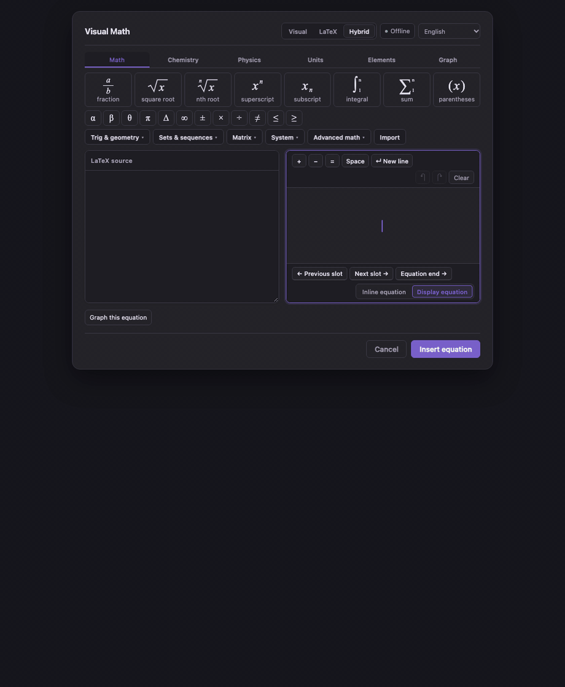
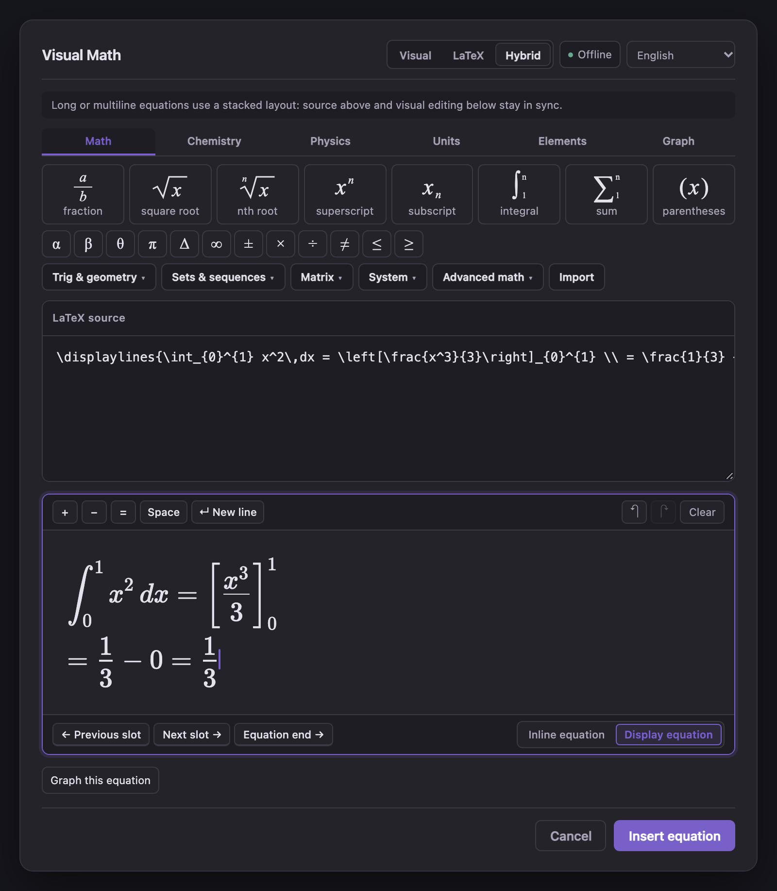
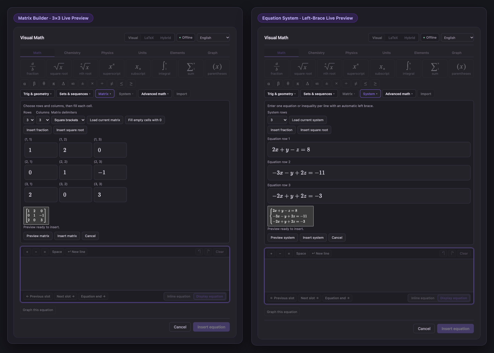
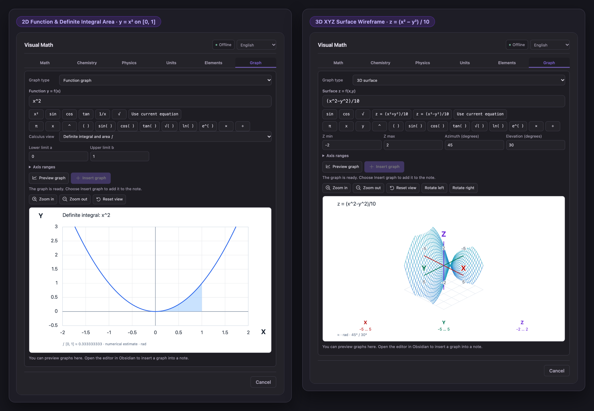
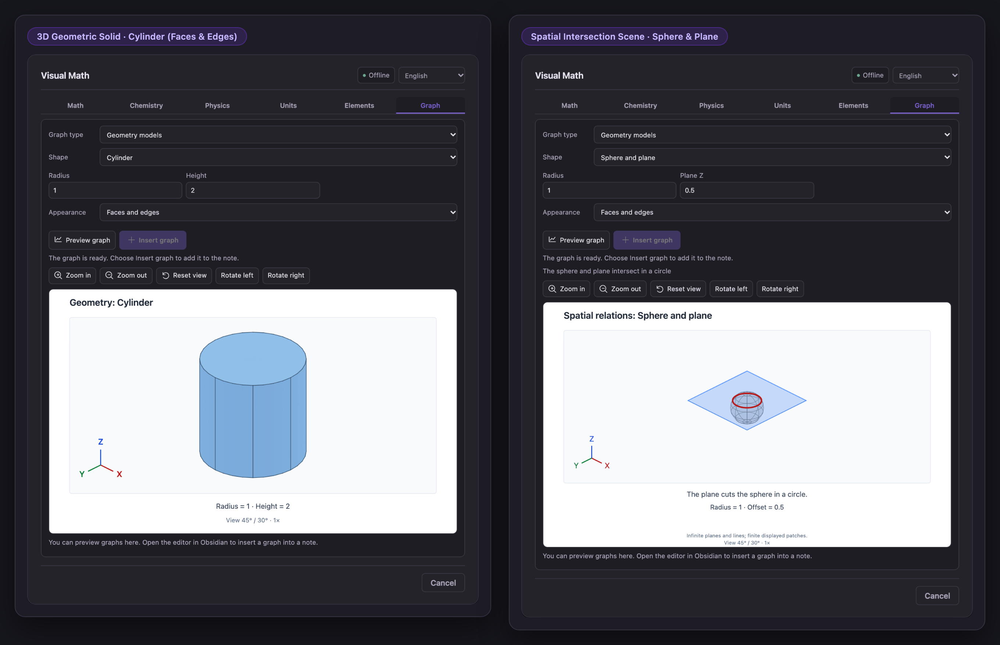
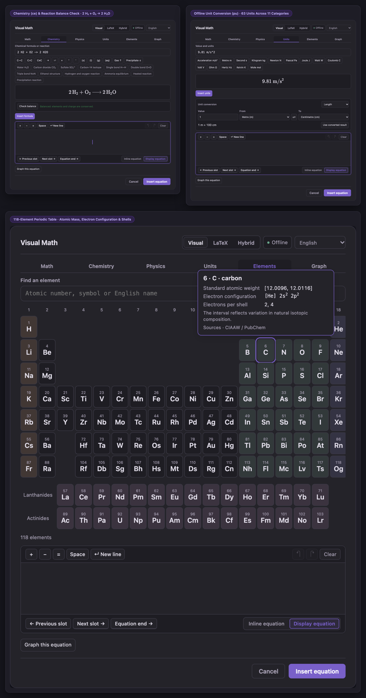

# Visual Math para Obsidian

[English](README.md) · [简体中文](README.zh-CN.md) · **Español**

**[Instalar en Obsidian](https://community.obsidian.md/plugins/visual-math-editor)** · **[Sitio web oficial](https://oranipost.github.io/visual-math/)** · **[Tutoriales en YouTube](https://www.youtube.com/@VisualMathForObsidian)** · **[Descargar ZIP 1.1.0](https://github.com/oranipost/visual-math-editor/releases/download/1.1.0/visual-math-editor-1.1.0.zip)** · **[Notas de la versión](https://github.com/oranipost/visual-math-editor/releases/tag/1.1.0)**

## Descripción general

Creé **Visual Math** para que puedas escribir apuntes de matemáticas, química y física en Obsidian sin tener que teclear código LaTeX a mano cada vez.

Al abrir el editor dentro de una nota, puedes pulsar fracciones, raíces, integrales, sumatorios, matrices o sistemas de ecuaciones y rellenar las casillas directamente. Si ya conoces LaTeX, cambia al modo **LaTeX** o **Hybrid** para editar el código y la fórmula en paralelo. Pulsa `↵ Nueva línea` (`Shift+Enter`) cuando quieras escribir varias líneas dentro del mismo bloque de ecuación.

Todo se guarda como Markdown estándar `$…$` o `$$…$$` en tu nota, y todas las fuentes, tablas de unidades y herramientas de gráficas funcionan localmente sin conexión.

- **Sitio web y guía de funciones**: [oranipost.github.io/visual-math](https://oranipost.github.io/visual-math/)
- **Tutoriales en vídeo**: [@VisualMathForObsidian en YouTube](https://www.youtube.com/@VisualMathForObsidian)



---

## Qué incluye

- **Edición Visual, LaTeX e Hybrid**: Edita con casillas visuales, código TeX directo o ambos a la vez. Incluye ecuaciones de varias líneas (`↵ Nueva línea`), historial para deshacer/rehacer e importación de fórmulas individuales en LaTeX.
- **Matrices, sistemas, conjuntos y notación de cálculo**: Crea matrices de `1×1` a `6×6`, sistemas de `2–6` filas con llave izquierda, 19 símbolos de conjuntos y sucesiones, notación trigonométrica/geométrica y 9 plantillas de cálculo y vectores.
- **Gráficas de funciones, polares, superficies 3D y plano complejo**: Grafica `y = f(x)` (con derivadas numéricas de 1.er y 2.º orden e integrales definidas), curvas polares `r = f(θ)`, superficies 3D `z = f(x, y)` y puntos complejos `Re / Im` justo debajo de la ecuación.
- **Modelos geométricos 3D**: Gira y amplía 7 sólidos geométricos (esfera, cilindro, cono, pirámide, prisma, ortoedro y plano) y 3 escenas de intersección espacial (dos planos, recta y plano, esfera y plano).
- **Química, física, unidades y tabla periódica**: Escribe reacciones químicas (`\ce`) con comprobación de ajuste, inserta fórmulas de física, convierte entre 63 unidades en 11 categorías (`\pu`) y consulta los 118 elementos.
- **Sin conexión y trilingüe**: Funciona sin internet ni cuentas externas. Disponible en **Español**, **English** y **简体中文**.

---

## Inicio rápido

1. **Abre el editor**: Coloca el cursor en tu nota y pulsa **∑** en la cabecera o en la barra lateral izquierda (o ejecuta `Visual Math: Insertar o editar ecuación` desde la paleta de comandos).
2. **Rellena una estructura**: En modo **Visual**, pulsa **fracción**, escribe `3`, pulsa `Tab` y escribe `4`. Usa la barra secundaria (`Trigonometría y geometría`, `Conjuntos y sucesiones`, `Matriz`, `Sistema`, `Matemáticas avanzadas`, `Importar`) cuando necesites estructuras más grandes.
3. **Guarda o grafica**: Elige **Ecuación en línea** (`$…$`) o **Ecuación en bloque** (`$$…$$`) en la esquina inferior derecha de la tarjeta y pulsa **Insertar ecuación** (`Ctrl/Cmd + Enter`), o pulsa **Graficar esta ecuación** para dibujar la gráfica debajo del editor.

---

## Instalación

### Desde los complementos comunitarios de Obsidian

1. Abre **[Visual Math en el directorio de complementos de Obsidian](https://community.obsidian.md/plugins/visual-math-editor)** y pulsa **Add to Obsidian**.
2. Pulsa **Install** y luego **Enable** dentro de Obsidian.
3. Abre cualquier nota Markdown y pulsa **∑**.

### Instalación manual por ZIP (Versión de escritorio 1.1.0)

Descarga **[visual-math-editor-1.1.0.zip](https://github.com/oranipost/visual-math-editor/releases/download/1.1.0/visual-math-editor-1.1.0.zip)** (archivo compilado; no descargues el archivo *Source code* de GitHub):

1. Extrae la carpeta `visual-math-editor` dentro de `<tu-bóveda>/.obsidian/plugins/`.
2. Comprueba que `main.js`, `manifest.json`, `styles.css` y los archivos de licencia estén directamente dentro de `.obsidian/plugins/visual-math-editor/`.
3. Reinicia Obsidian y activa **Visual Math** en **Settings → Community plugins**.

Consulta la [guía de instalación y actualización](docs/INSTALLATION.md) para más detalles.

---

## Capturas de pantalla (v1.1.0)

### Modo Hybrid, ecuaciones multilínea y barra compacta


### Matrices visuales y sistemas de ecuaciones


### Cálculo en funciones 2D y superficies XYZ 3D


### Sólidos geométricos 3D y escenas espaciales


### Ajuste químico, conversor de unidades y tabla periódica


---

<details>
<summary><strong>Alcance técnico, límites e instrucciones de compilación local (Haz clic para desplegar)</strong></summary>

### Alcance y límites

- **Notación y gráficas numéricas acotadas**: Visual Math da formato a la notación matemática y científica y genera gráficas numéricas y escenas geométricas didácticas. No resuelve ecuaciones simbólicamente, no calcula operaciones matriciales, no ordena conjuntos ni demuestra teoremas.
- **Importación de una fórmula**: Admite código LaTeX sin delimitadores o con un par externo coincidente (`$…$`, `$$…$$`, `\(...\)`, `\[...\]`) de hasta **8.192 caracteres**. Hasta **4.096 caracteres** se muestra la vista previa visual; las fórmulas válidas de entre 4.097 y 8.192 caracteres conservan su código íntegro para editarse en modo LaTeX o Hybrid sin recortes.
- **Matrices y sistemas**: `1–6` filas/columnas para matrices y `2–6` filas de una sola columna para sistemas (`cases`). Rellenar celdas vacías con `0` es una acción explícita; cambiar filas o columnas conserva las celdas ocultas durante la sesión actual.
- **Gráficas y geometría**:
  - Funciones explícitas `y = f(x)` (hasta 500 caracteres), curvas polares `r = f(θ)` (intervalo de `θ` hasta `100π`), derivadas numéricas de 1.er/2.º orden e integrales definidas en intervalos continuos finitos, superficies 3D `z = f(x, y)` y hasta 20 puntos complejos (`a + bi`, hasta 1.000 caracteres).
  - Tras guardar, la fórmula (`$…$` / `$$…$$`) y el bloque `vme-plot` son independientes en la nota; utiliza **Editar gráfica** o **Guardar vista** para actualizar la vista guardada.
- **Compatibilidad**: Requiere **Obsidian 1.14.4+** en escritorio. Los registros de pruebas están en [TEST-REPORT.md](TEST-REPORT.md) y [CHANGELOG.md](CHANGELOG.md).

### Compilación desde el código fuente

Requiere Node.js 22 o 24:

```sh
npm ci
npm run check
npm run package
```

Vista previa local para desarrollo (`http://127.0.0.1:8471`):

```sh
npm run preview
```

</details>

---

## Privacidad, soporte y licencia

- **Sin conexión y privado**: Sin telemetría, sin fuentes ni servidores externos y sin vigilancia del portapapeles en segundo plano. Consulta [SECURITY.md](SECURITY.md).
- **Autor y contacto**: Creado por [Oliver / oranipost](https://github.com/oranipost) ([oranipost@outlook.com](mailto:oranipost@outlook.com)). Informa de errores o sugerencias en [GitHub Issues](https://github.com/oranipost/visual-math-editor/issues).
- **Licencia**: Desde la versión 0.7.0, el código del proyecto se distribuye bajo [GNU GPL v3.0 únicamente con la excepción de enlace para Obsidian](LICENSING.md) (Copyright © 2026 Dongfang Wang; las versiones `≤ 0.6.5` conservan su licencia MIT original). Las licencias de terceros están en [THIRD-PARTY-NOTICES.md](THIRD-PARTY-NOTICES.md). Tus propios apuntes y fórmulas nunca quedan sujetos a GPL.
