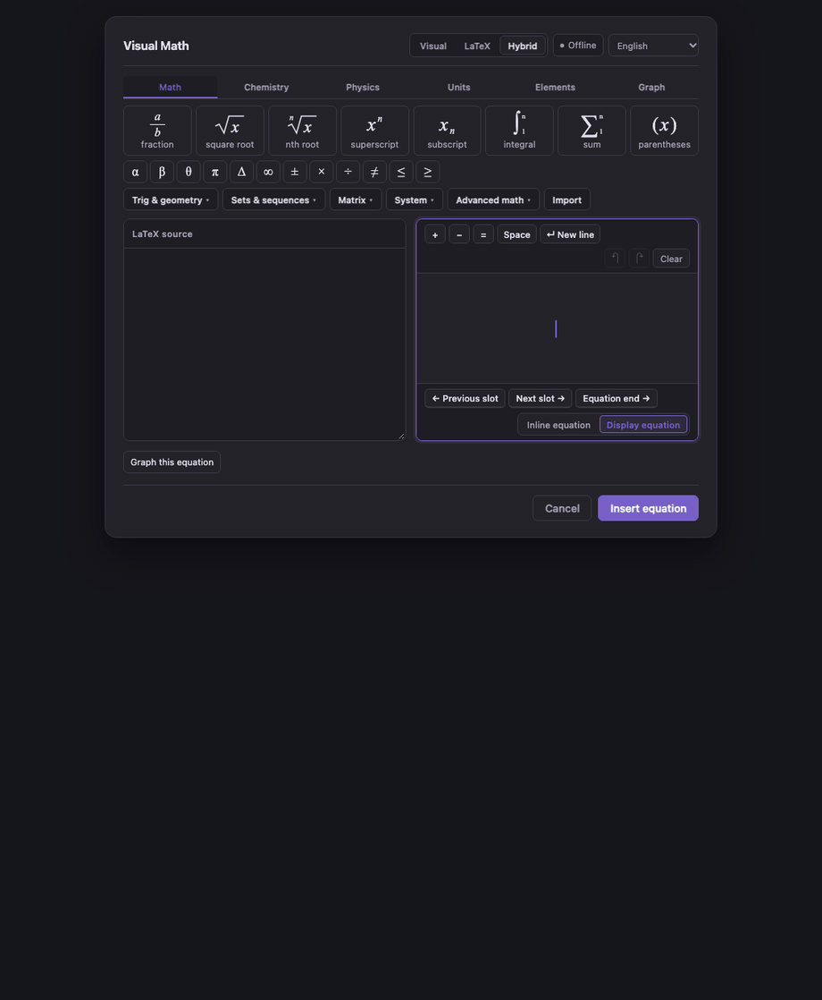
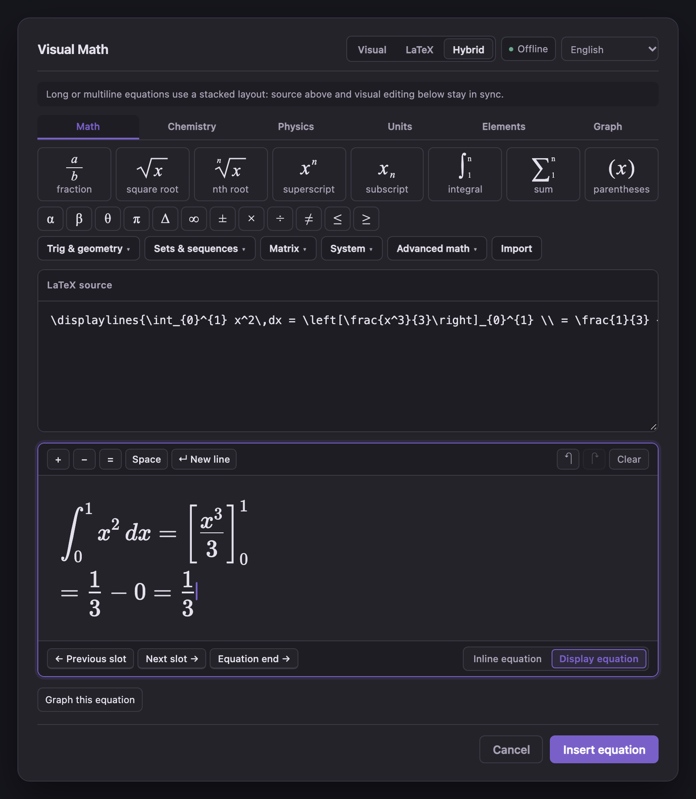
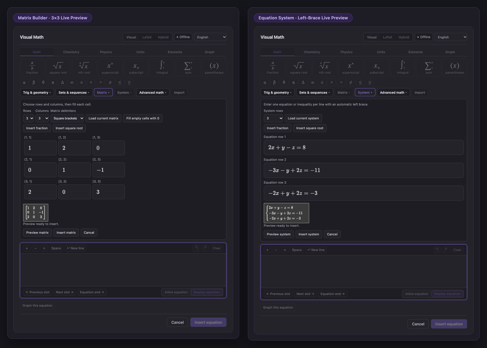
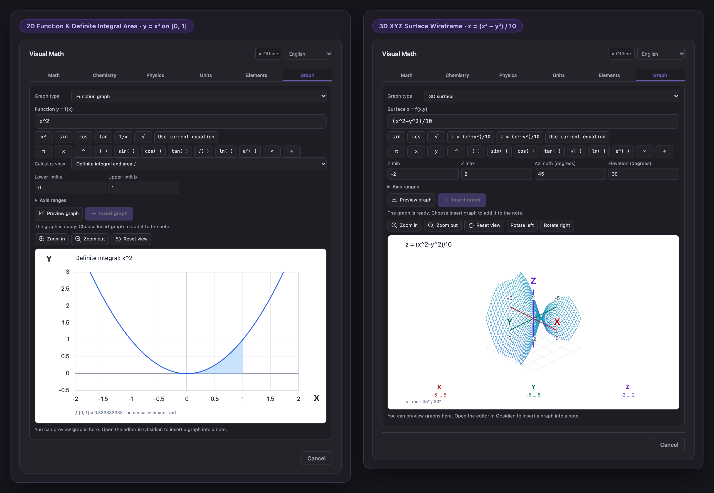
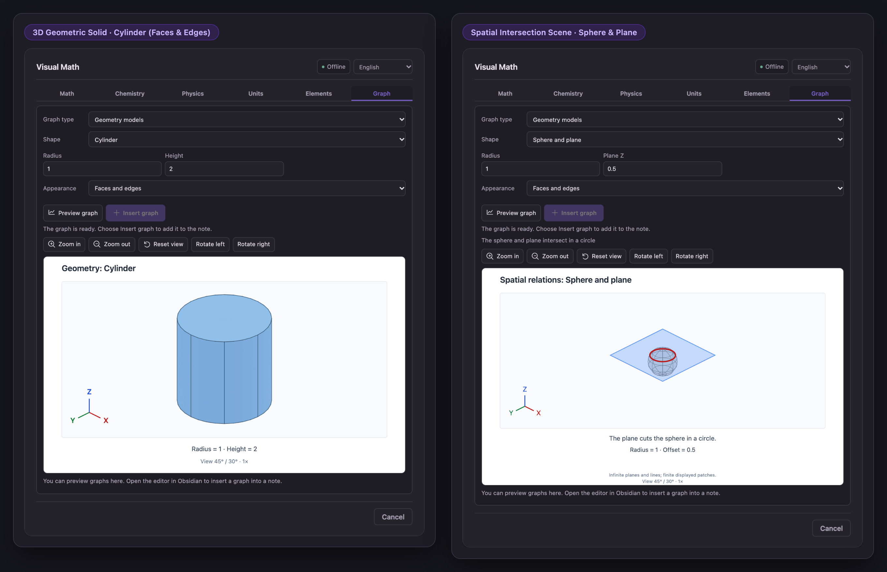
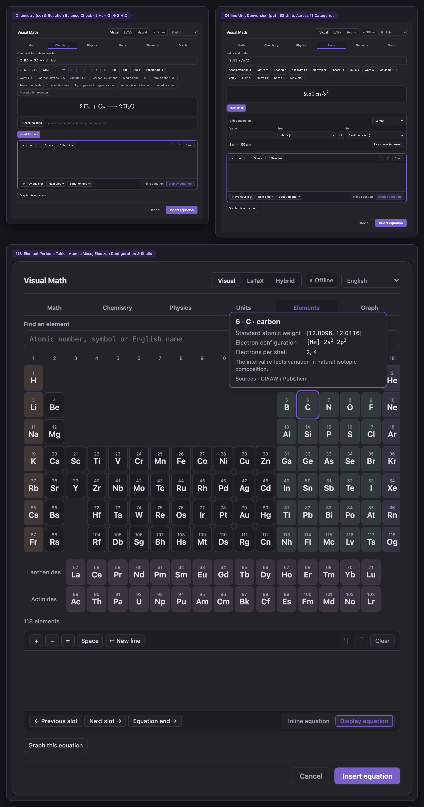

# Visual Math pour Obsidian

[English](README.md) · [简体中文](README.zh-CN.md) · [Español](README.es.md) · [日本語](README.ja.md) · [Deutsch](README.de.md) · **Français**

**[Installer dans Obsidian](https://community.obsidian.md/plugins/visual-math-editor)** · **[Site officiel](https://oranipost.github.io/visual-math/)** · **[Tutoriels YouTube](https://www.youtube.com/@VisualMathForObsidian)** · **[Télécharger le ZIP 1.1.2](https://github.com/oranipost/visual-math-editor/releases/download/1.1.2/visual-math-editor-1.1.2.zip)** · **[Notes de version](https://github.com/oranipost/visual-math-editor/releases/tag/1.1.2)**

## Présentation

J’ai créé **Visual Math** pour pouvoir rédiger des notes de mathématiques, de chimie et de physique dans Obsidian sans avoir à taper du code LaTeX brut à la main à chaque fois.

Lorsque vous ouvrez l’éditeur dans une note, vous pouvez cliquer sur des fractions, racines, intégrales, sommes, matrices ou systèmes d’équations et remplir directement les cases. Si vous connaissez déjà LaTeX, passez en mode **LaTeX** ou **Hybride** pour modifier le code et la formule côte à côte. Appuyez sur `↵ Nouvelle ligne` (`Shift+Enter`) dès que vous souhaitez écrire sur plusieurs lignes dans le même bloc d’équation.

Tout est enregistré en Markdown standard `$…$` ou `$$…$$` dans votre note, et toutes les polices, tables d’unités et outils graphiques fonctionnent à 100 % localement hors ligne — sans IA, sans compte cloud et sans abonnement payant.

- **Site web et guide des fonctionnalités** : [oranipost.github.io/visual-math](https://oranipost.github.io/visual-math/)
- **Tutoriels vidéo** : [@VisualMathForObsidian sur YouTube](https://www.youtube.com/@VisualMathForObsidian)



---

## Fonctionnalités

- **Édition Visuelle, LaTeX et Hybride** : Éditez avec des cases visuelles, du code TeX direct ou les deux à la fois. Inclut les équations multilignes (`↵ Nouvelle ligne`), l’historique annuler/rétablir et l’importation d’une formule LaTeX.
- **Matrices, systèmes, lettres grecques, ensembles et analyse** : Créez des matrices de `1×1` à `6×6`, des systèmes de `2 à 6` lignes avec accolade gauche, les 41 lettres grecques (`α–ω`, variantes et majuscules), 19 symboles d’ensembles et de suites, la notation trigonométrique/géométrique et 9 modèles d’analyse et de vecteurs.
- **Graphiques de fonctions, polaires, surfaces 3D et plan complexe** : Tracez `y = f(x)` (avec dérivées numériques d’ordre 1 et 2 et intégrales définies), des courbes polaires `r = f(θ)`, des surfaces 3D `z = f(x, y)` et des points complexes `Re / Im` juste sous votre équation, ou copiez n’importe quel graphique en image PNG en un clic.
- **Géométrie 3D et solides composés** : Faites pivoter et zoomez sur 9 formes géométriques (sphère, hémisphère, cylindre, cône, tronc circulaire ou polygonal, pyramide régulière, prisme régulier, pavé droit, plan), assemblez de `2 à 6` pièces en solides composés 3D (avec modèles d’exercices, décalages, rotations et styles plein/translucide/fil de fer) et explorez 3 scènes d’intersection dans l’espace (deux plans, droite et plan, sphère et plan).
- **Chimie, physique, unités et tableau périodique à 10 familles** : Écrivez des réactions chimiques (`\ce`) avec vérification d’équilibrage, insérez 24 modèles de physique, convertissez 66 unités réparties en 11 catégories (`\pu`, dont `eV`, `keV`, `MeV`) et consultez les 118 éléments classés en 10 familles chimiques avec une barre dédiée aux équations chimiques (`→`, `⇌`, `Δ`, `↑`, `↓`, indices, charges et états).
- **100 % local hors ligne et en 6 langues** : Fonctionne entièrement sans internet, sans IA et sans compte externe. Disponible en **Français**, **English**, **简体中文**, **Español**, **日本語** et **Deutsch**.

---

## Démarrage rapide

1. **Ouvrir l’éditeur** : Placez le curseur dans une note et cliquez sur **∑** dans l’en-tête de la note ou la barre latérale gauche (ou lancez `Visual Math : Insérer ou modifier une équation` depuis la palette de commandes).
2. **Remplir une structure** : En mode **Visuel**, cliquez sur **Fraction**, tapez `3`, appuyez sur `Tab`, puis tapez `4`. Utilisez la barre secondaire (`αβ Lettres grecques`, `Trigo & géométrie`, `Ensembles & suites`, `Matrice`, `Système`, `Maths avancées`, `Importer`) lorsque vous avez besoin de symboles ou structures supplémentaires.
3. **Enregistrer ou tracer** : Choisissez **Formule dans le texte** (`$…$`) ou **Ligne séparée** (`$$…$$`) en bas à droite de la carte puis cliquez sur **Insérer la formule** (`Ctrl/Cmd + Enter`), ou cliquez sur **Tracer cette équation** pour afficher le graphique directement sous l’éditeur.

---

## Installation

### Depuis les plugins communautaires d’Obsidian

1. Ouvrez **[Visual Math dans le répertoire des plugins Obsidian](https://community.obsidian.md/plugins/visual-math-editor)** et cliquez sur **Add to Obsidian**.
2. Cliquez sur **Install**, puis sur **Enable** dans Obsidian.
3. Ouvrez n’importe quelle note Markdown et cliquez sur **∑**.

### Installation manuelle par ZIP (Version bureau 1.1.2)

Téléchargez **[visual-math-editor-1.1.2.zip](https://github.com/oranipost/visual-math-editor/releases/download/1.1.2/visual-math-editor-1.1.2.zip)** (archive compilée ; ne téléchargez pas l’archive *Source code* de GitHub) :

1. Extrayez le dossier `visual-math-editor` dans `<votre-coffre>/.obsidian/plugins/`.
2. Vérifiez que `main.js`, `manifest.json`, `styles.css` et les fichiers de licence se trouvent directement dans `.obsidian/plugins/visual-math-editor/`.
3. Redémarrez Obsidian et activez **Visual Math** dans **Paramètres → Plugins communautaires**.

Consultez le [guide d’installation et de mise à jour](docs/INSTALLATION.md) pour plus de détails.

---

## Captures d’écran (v1.1.2)

### Mode Hybride, équations multilignes et barre compacte


### Matrices visuelles et systèmes d’équations


### Analyse de fonctions 2D et surfaces XYZ 3D


### Solides géométriques 3D et intersections dans l’espace


### Équilibrage chimique, convertisseur d’unités et tableau périodique


---

<details>
<summary><strong>Cadre technique, limites et compilation locale (Cliquer pour déplier)</strong></summary>

### Portée et limites

- **Notation et tracés numériques bornés** : Visual Math met en forme la notation mathématique et scientifique et génère des graphiques numériques ainsi que des scènes géométriques pédagogiques. Il ne résout pas les équations de manière symbolique, n’évalue pas les opérations matricielles, ne trie pas les ensembles et ne démontre pas de théorèmes.
- **Importation d’une formule unique** : Accepte du LaTeX brut ou une paire de délimiteurs externes correspondants (`$…$`, `$$…$$`, `\(...\)`, `\[...\]`) jusqu’à **8 192 caractères**. Jusqu’à **4 096 caractères**, un aperçu visuel en direct est affiché ; entre 4 097 et 8 192 caractères, le code exact est conservé sans troncature pour être modifié en mode LaTeX ou Hybride.
- **Matrices et systèmes** : `1 à 6` lignes/colonnes pour les matrices et `2 à 6` lignes à une colonne pour les systèmes (`cases`). Le remplissage des cases vides par `0` est explicite ; le redimensionnement conserve les cases masquées pendant la session en cours.
- **Graphiques et géométrie** :
  - Fonctions explicites `y = f(x)` (jusqu’à 500 caractères), courbes polaires `r = f(θ)` (intervalle de `θ` jusqu’à `100π`), dérivées numériques d’ordre 1 et 2 et intégrales définies sur des intervalles continus finis, surfaces 3D `z = f(x, y)` et jusqu’à 20 points complexes (`a + bi`, jusqu’à 1 000 caractères).
  - Après l’enregistrement, le bloc de formule (`$…$` / `$$…$$`) et le bloc graphique (`vme-plot`) sont indépendants dans la note ; utilisez **Modifier le graphique** ou **Enregistrer la vue** pour mettre à jour la vue enregistrée.
- **Outils scientifiques** : La chimie (`\ce{…}`) et les unités (`\pu{…}`) nécessitent la prise en charge de `mhchem` lors d’un export hors d’Obsidian. La conversion d’unités hors ligne couvre 66 unités réparties en 11 catégories à partir des constantes Convert 8.0.2 et de la définition exacte SI 2019 de l’électronvolt ; les données des éléments suivent les références CIAAW et NIST.
- **Compatibilité** : Nécessite **Obsidian 1.14.4+** sur ordinateur. Les rapports de vérification figurent dans [TEST-REPORT.md](TEST-REPORT.md) et [CHANGELOG.md](CHANGELOG.md).

### Compiler depuis les sources

Nécessite Node.js 22 ou 24 :

```sh
npm ci
npm run check
npm run package
```

Aperçu local des composants pour le développement (`http://127.0.0.1:8471` uniquement) :

```sh
npm run preview
```

Voir [CONTRIBUTING.md](CONTRIBUTING.md), [RELEASING.md](RELEASING.md), [LANGUAGE-SUPPORT.md](LANGUAGE-SUPPORT.md) et [third-party-sources/README.md](third-party-sources/README.md).

</details>

---

## Confidentialité, support et licence

- **Hors ligne et privé** : Aucune télémétrie, aucune police ou CDN distant, et aucune surveillance du presse-papiers en arrière-plan. Voir [SECURITY.md](SECURITY.md).
- **Auteur et contact** : Créé par [Oliver / oranipost](https://github.com/oranipost) ([oranipost@outlook.com](mailto:oranipost@outlook.com)). Signalez les bugs ou suggestions sur [GitHub Issues](https://github.com/oranipost/visual-math-editor/issues).
- **Licence** : Depuis la version 0.7.0, le code du projet est distribué sous licence [GNU GPL v3.0 uniquement avec l’exception de liaison pour Obsidian](LICENSING.md) (Copyright © 2026 Dongfang Wang ; le code `≤ 0.6.5` conserve sa licence MIT d’origine). Les licences des composants tiers intégrés (MathLive, Convert, polices KaTeX sous MIT et mhchem sous Apache 2.0) sont détaillées dans [THIRD-PARTY-NOTICES.md](THIRD-PARTY-NOTICES.md). Vos propres notes et formules ne sont jamais soumises à la GPL.
