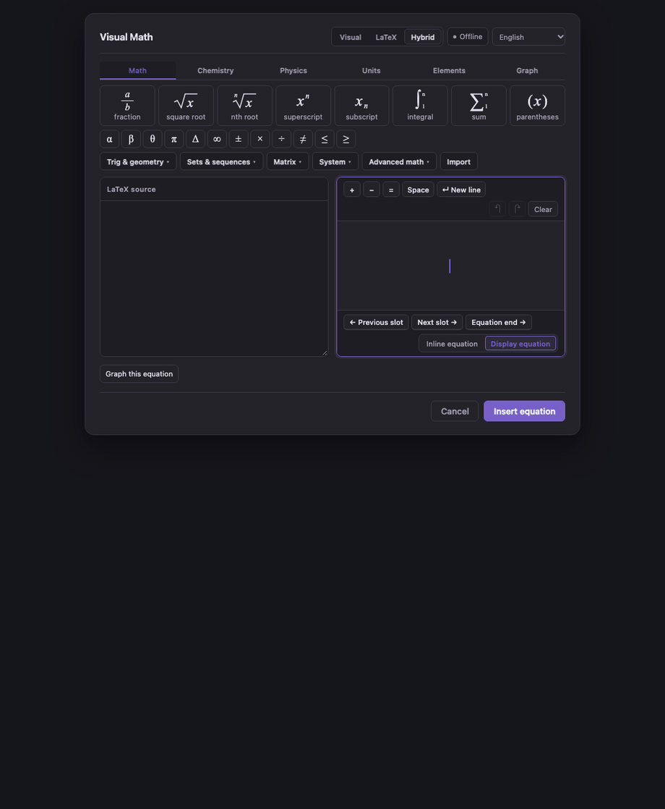
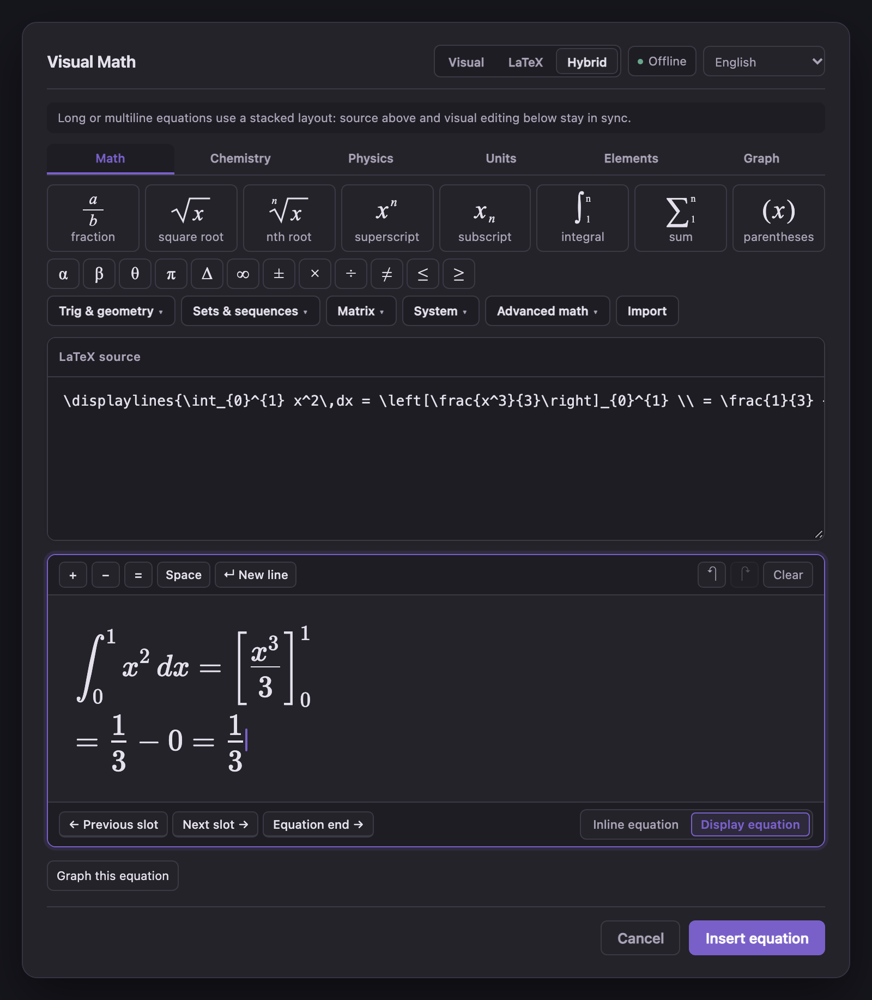
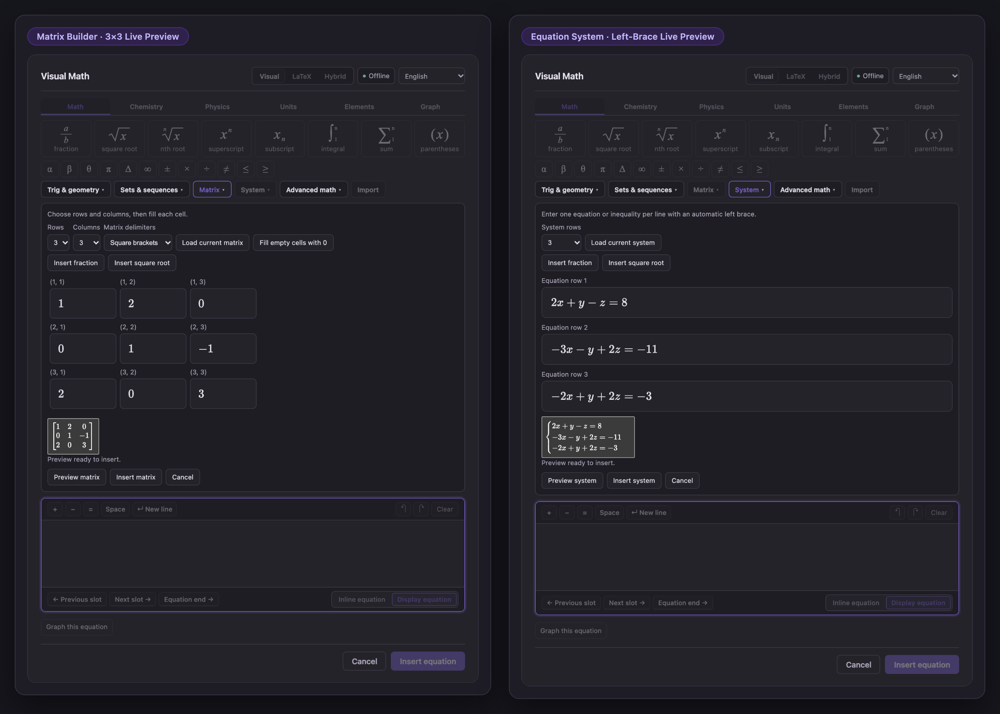
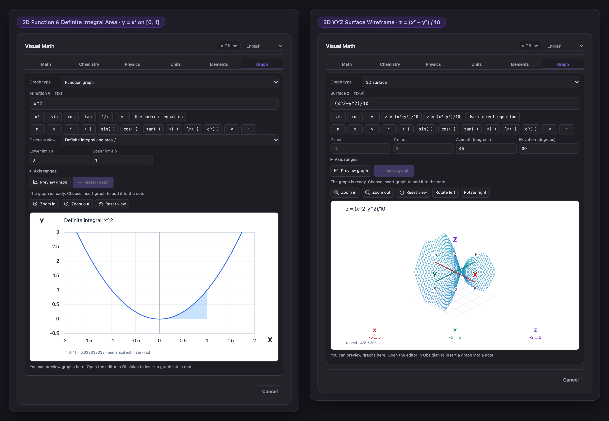
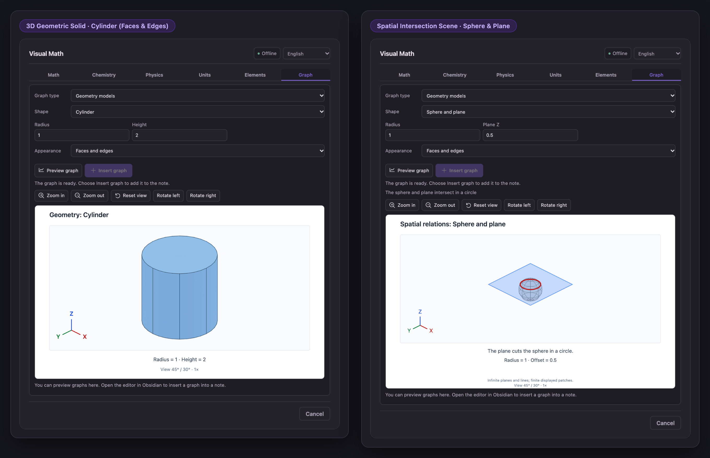
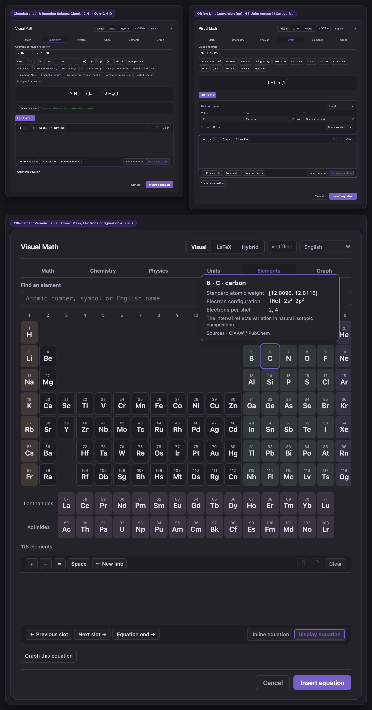

# Visual Math for Obsidian

[English](README.md) · [简体中文](README.zh-CN.md) · [Español](README.es.md) · **日本語** · [Deutsch](README.de.md) · [Français](README.fr.md)

**[Obsidian にインストール](https://community.obsidian.md/plugins/visual-math-editor)** · **[公式サイト](https://oranipost.github.io/visual-math/)** · **[YouTube チュートリアル](https://www.youtube.com/@VisualMathForObsidian)** · **[1.1.2 ZIP をダウンロード](https://github.com/oranipost/visual-math-editor/releases/download/1.1.2/visual-math-editor-1.1.2.zip)** · **[リリースノート](https://github.com/oranipost/visual-math-editor/releases/tag/1.1.2)**

## 概要

Obsidian で数学・化学・物理のノートを書くときに、毎回 LaTeX コードを手打ちしなくても済むように **Visual Math** を作りました。

ノート内でエディターを開くと、分数、根号、積分、総和、行列、連立方程式のボタンをクリックして、空欄に直接数字や文字を入力できます。すでに LaTeX に慣れている方は、**LaTeX** モードや **Hybrid** モードに切り替えて、ソースコードと数式プレビューを並べて編集できます。同じ数式ブロック内で改行したいときは `↵ 改行`（`Shift+Enter`）を押してください。

作成した数式はすべて標準の `$…$` または `$$…$$` Markdown として保存され、内蔵フォント・単位換算表・グラフ描画ツールはすべて 100% ローカルのオフライン環境で動作します（AI 不使用・クラウドアカウント不要・有料サブスクリプションなし）。

- **公式サイト・機能ガイド**: [oranipost.github.io/visual-math](https://oranipost.github.io/visual-math/)
- **動画チュートリアル**: [YouTube @VisualMathForObsidian](https://www.youtube.com/@VisualMathForObsidian)



---

## 主な機能

- **Visual・LaTeX・Hybrid の 3 モード**: 視覚的な空欄入力、TeX ソースの直接編集、または左右同時編集に対応。数式内の複数行改行（`↵ 改行`）、元に戻す／やり直し履歴、単一 LaTeX 数式のインポートを備えています。
- **行列・連立方程式・全ギリシャ文字・集合・微積分記法**: `1×1`〜`6×6` の行列、左中括弧付きの `2〜6` 行の連立方程式、全 41 種のギリシャ文字（小文字 `α–ω`・異体字・大文字）、19 種類の集合・数列記号、三角関数・幾何記号、9 種類の微積分・ベクトルテンプレートを収録。
- **関数・極座標・3D 曲面・複素平面グラフ**: 数式のすぐ下に `y = f(x)`（1 階／2 階数値微分および定積分の面積表示に対応）、極座標曲線 `r = f(θ)`、3D 曲面 `z = f(x, y)`、複素平面 `Re / Im` の点プロットを描画でき、ワンクリックで PNG 画像としてクリップボードにコピーできます。
- **3D 幾何モデル・複合立体モデリング・空間関係**: 9 種類の基本立体（球、半球、円柱、円錐、円錐台／正角錐台、正角錐、正角柱、直方体、平面パッチ）に加え、`2〜6` 個の立体を組み合わせる複合立体モデリング（球に内接する立方体、円柱＋円錐などの問題テンプレート、パーツ別のオフセット・回転・ソリッド／半透明／ワイヤーフレーム表示）、および 3 種類の空間交差シーン（2 平面、直線と平面、球と平面）に対応。
- **化学・物理・単位換算・10 分類周期表**: 化学反応式（`\ce`）の入力と係数つり合いチェック、24 種類の物理公式テンプレート、11 カテゴリ 66 単位のオフライン換算（`\pu`、`eV`・`keV`・`MeV` 対応）、化学反応式ショートカットバー（`→`、`⇌`、`Δ`、`↑`、`↓`、下付き、電荷、状態記号）付きの全 118 元素 10 分類周期表に対応。
- **100% ローカルオフライン・6 言語対応**: AI や外部通信を一切使わず完全オフラインで動作します。**日本語**、**English**、**简体中文**、**Español**、**Deutsch**、**Français** の 6 言語に対応しています。

---

## クイックスタート

1. **エディターを開く**: ノートの本文にカーソルを置き、ノート上部または左リボンにある **∑** をクリックします（またはコマンドパレットから `Visual Math: 数式を挿入または編集` を実行します）。
2. **構造に入力する**: **Visual** モードで **分数** をクリックし、`3` を入力して `Tab` キーを押し、分母に `4` を入力します。より多くの記号や構造が必要なときは、下部のピル型ツールバー（`αβ ギリシャ文字`、`三角関数・幾何`、`集合と数列`、`行列`、`連立方程式`、`高等数学`、`数式読込`）を開きます。
3. **保存またはグラフ描画**: カード右下で **文中の数式**（`$…$`）または **独立した行**（`$$…$$`）を選び、**数式を挿入**（`Ctrl/Cmd + Enter`）をクリックします。**この数式をグラフ化** をクリックすると、エディターの下にそのままグラフを描画できます。

---

## インストール方法

### Obsidian コミュニティプラグインからインストール

1. **[Obsidian プラグインディレクトリ内の Visual Math](https://community.obsidian.md/plugins/visual-math-editor)** を開き、**Add to Obsidian** をクリックします。
2. Obsidian 内で **Install** をクリックし、続けて **Enable** をクリックします。
3. 任意の Markdown ノートを開き、**∑** をクリックして使い始めます。

### ZIP からの手動インストール（1.1.2 デスクトップ版）

ビルド済みの **[visual-math-editor-1.1.2.zip](https://github.com/oranipost/visual-math-editor/releases/download/1.1.2/visual-math-editor-1.1.2.zip)** をダウンロードします（GitHub 自動生成の *Source code* アーカイブではなく、リリース ZIP をダウンロードしてください）：

1. 解凍した `visual-math-editor` フォルダを `<あなたの保管庫>/.obsidian/plugins/` に配置します。
2. `.obsidian/plugins/visual-math-editor/` の直下に `main.js`、`manifest.json`、`styles.css`、およびライセンスファイルがあることを確認します。
3. Obsidian を再起動し、**設定 → コミュニティプラグイン** で **Visual Math** を有効化します。

詳しい手順は [インストールと更新ガイド](docs/INSTALLATION.md) をご覧ください。

---

## スクリーンショット (v1.1.2)

### Hybrid モード・複数行数式・コンパクトツールバー


### 行列エディターと連立方程式エディター


### 2D 関数の微積分表示と 3D XYZ 曲面


### 3D 幾何モデルと空間交差シーン


### 化学反応式の係数チェック・単位換算・周期表


---

<details>
<summary><strong>技術仕様・制限事項・ローカルビルド手順（クリックして展開）</strong></summary>

### 対応範囲と制限事項

- **数式記法と有界な数値グラフ描画に特化**: Visual Math は数学・科学記法の組版と、数値近似グラフおよび学習用の幾何シーン描画を行うツールです。記号代数による方程式の厳密解法、行列演算の計算、集合の自動ソート・重複削除、定理の自動証明は行いません。
- **単一数式のインポート上限**: 区切り記号なしの LaTeX、または外側の区切り記号 1 組（`$…$`、`$$…$$`、`\(...\)`、`\[...\]`）を含む最大 **8,192 文字** の数式に対応。**4,096 文字** 以下はリアルタイムの視覚プレビューを表示し、4,097〜8,192 文字の有効な数式は切り詰めずにソースを保持して LaTeX／Hybrid モードで編集・保存できます。
- **行列と連立方程式**: 行列は `1〜6` 行×列、連立方程式（`cases`）は `2〜6` 行に対応。「空欄に 0 を入れる」で未入力セルを一括補完でき、サイズ変更時も現在のセッション中は非表示セルの内容を保持します。
- **グラフと幾何モデル**:
  - 陽関数 `y = f(x)`（最大 500 文字）、極座標 `r = f(θ)`（`θ` 幅は最大 `100π`）、有限連続区間での 1 階／2 階数値微分と定積分、3D ワイヤーフレーム曲面 `z = f(x, y)`、および最大 20 個の複素数点（`a + bi`、合計 1,000 文字）に対応。
  - ノート保存後、数式ブロック（`$…$` / `$$…$$`）とグラフブロック（`vme-plot`）は独立したブロックとして保存されます。保存済みグラフの更新には **グラフを編集** または **表示を保存** を使用します。
- **科学ツール**: 化学（`\ce{…}`）および単位（`\pu{…}`）を Obsidian 外へエクスポートする場合は、出力先環境の `mhchem` 対応が必要です。オフライン単位換算は固定された Convert 8.0.2 定数および 2019 SI 電子ボルト定義に基づき 11 カテゴリ 66 単位に対応し、元素データは CIAAW および NIST 基準に準拠しています。
- **互換性**: デスクトップ版 **Obsidian 1.14.4 以上** が必要です。検証記録は [TEST-REPORT.md](TEST-REPORT.md) と [CHANGELOG.md](CHANGELOG.md) に記載しています。

### ソースからのビルド

Node.js 22 または 24 が必要です：

```sh
npm ci
npm run check
npm run package
```

ローカルでのコンポーネント開発プレビュー（`127.0.0.1:8471` のみにバインド）：

```sh
npm run preview
```

詳細は [CONTRIBUTING.md](CONTRIBUTING.md)、[RELEASING.md](RELEASING.md)、[LANGUAGE-SUPPORT.md](LANGUAGE-SUPPORT.md)、および [third-party-sources/README.md](third-party-sources/README.md) を参照してください。

</details>

---

## プライバシー・サポート・ライセンス

- **オフライン＆プライバシー保護**: テレメトリ送信なし、外部フォントや CDN への通信なし、バックグラウンドでのクリップボード監視もありません（クリップボードはエディター内で明示的にコピー・切り取り・貼り付けを行ったときのみ使用します）。詳細は [SECURITY.md](SECURITY.md) を参照してください。
- **開発者・連絡先**: [Oliver / oranipost](https://github.com/oranipost) ([oranipost@outlook.com](mailto:oranipost@outlook.com))。バグ報告や改善提案は [GitHub Issues](https://github.com/oranipost/visual-math-editor/issues) までお願いします。
- **ライセンス**: バージョン 0.7.0 以降のプロジェクトコードは [Obsidian リンク例外付き GNU GPL v3.0 only](LICENSING.md)（Copyright © 2026 Dongfang Wang、`≤ 0.6.5` のコードは従来の MIT ライセンスを保持）で提供されます。同梱の MathLive、Convert、KaTeX フォント（MIT）および mhchem（Apache 2.0）の表記は [THIRD-PARTY-NOTICES.md](THIRD-PARTY-NOTICES.md) に記載されています。あなたが作成するノートや数式自体に GPL が適用されることはありません。
