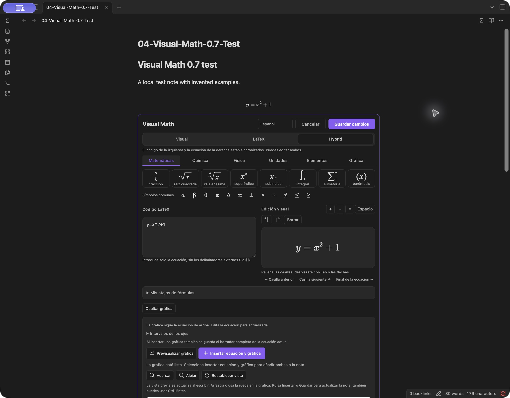
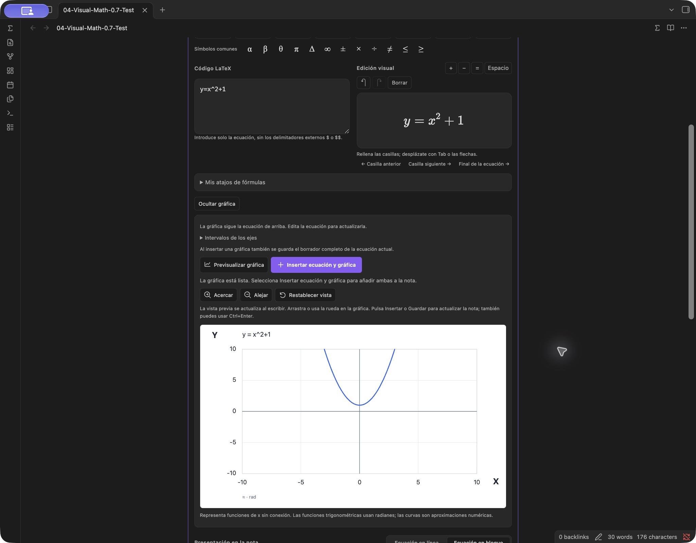

# Visual Math

English · [简体中文](README.zh-CN.md)

Write **math, chemistry and physics notes** directly inside Obsidian with **Visual Math** (formerly Visual Math Editor). Visual mode works like Word: choose fractions, roots, scripts, integrals and sums, then fill the placeholders. **Zero LaTeX knowledge is required in Visual mode.** LaTeX and synchronized Hybrid modes are available when you want source control; formulas remain ordinary LaTeX/Markdown.

Built for quick science notes: optional chemical balance suggestions, physics templates, a periodic table, offline unit conversion, function graphs and a Re/Im complex plane. Everything runs locally without an account or runtime network connection.

**0.7.0 · Desktop public beta.** This update introduces the Visual Math name, Spanish alongside English and Simplified Chinese, a graph preview below the current equation, and custom formula shortcuts. Download availability is shown on [GitHub Releases](https://github.com/oranipost/visual-math-editor/releases); local, native, hosted and release checks are recorded separately in [TEST-REPORT.md](TEST-REPORT.md). Preparing this version does not establish that its hosted build, public release or community review has completed. See [scope](MVP.md), [language support](LANGUAGE-SUPPORT.md) and [review observations](docs/COMMUNITY-SUBMISSION.md).

The display name changes; the plugin ID, repository URL and installation folder remain `visual-math-editor`, so existing preferences and saved graphs keep their identifiers.

## New in-note workflow

Real screenshots from Visual Math 0.7.0 running in Obsidian on macOS. The Spanish Hybrid interface and graph preview share the same equation draft. The detailed save/reopen and shortcut checks are recorded in the test report.





## Download and install

**[Open the Obsidian community-directory page](https://community.obsidian.md/plugins/visual-math-editor).** When the plugin is available in the app's index, click **Add to Obsidian**, allow the link to open Obsidian, then choose **Install → Enable** in the plugin details. Open a Markdown note and click **∑** in its header or left ribbon. The directory's enabled installation link and a completed native installation test are separate observations; consult [TEST-REPORT.md](TEST-REPORT.md) for what has actually been tested.

**Installation index, checked 2026-10-18:** the official index now includes `visual-math-editor` under its earlier display name **Visual Math Editor**. This is an index observation, not a completed installation through the app's marketplace and not confirmation that 0.7.0 is available there. If the app still shows the earlier name or version, use the version shown by its actual listing or the matching GitHub release. Native editing tests used manual installation; see the test report.

### Manual installation

**[0.7.0 installation ZIP](https://github.com/oranipost/visual-math-editor/releases/download/0.7.0/visual-math-editor-0.7.0.zip)** · [Release notes and checksums](https://github.com/oranipost/visual-math-editor/releases/tag/0.7.0) · [Detailed installation, updates and removal](docs/INSTALLATION.md#english)

Check [Releases](https://github.com/oranipost/visual-math-editor/releases) for availability before using a versioned download link. For manual installation, download the installation ZIP, rather than **Code → Download ZIP** or GitHub's automatic **Source code** archives, which require building.

The installation ZIP is already compiled. You do not need Node.js to use it.

1. Extract the ZIP and copy the entire `visual-math-editor` folder into your vault's `.obsidian/plugins/` directory.
2. Confirm that `main.js`, `manifest.json`, `styles.css` and the license files are directly inside that folder, without another nested plugin folder.
3. Restart Obsidian. Open **Settings → Community plugins**, enable community plugins if necessary, then enable **Visual Math**.
4. Open a Markdown note. Use **∑** in the note header or left ribbon to open the editor.

On macOS, **⌘⇧.** shows hidden folders in Finder. If your vault uses a custom configuration directory, use that instead of `.obsidian`.

For directory updates, use **Settings → Community plugins → Check for updates → Update**; community plugins do not update automatically. For manual updates, save or cancel open drafts, disable the plugin and back up its existing folder. Copy the new installation files into that folder and retain your existing `data.json` settings. Save drafts before either update method, then restart Obsidian to refresh MathLive. You do not need to edit code or download your vault again. See [how updates work](docs/UPDATING.md#english).

Requires **Obsidian 1.14.4 or later**. Native integration was tested on macOS with Obsidian 1.14.4. This release supports the desktop main window; Windows, Linux, mobile, detached pop-out windows and arbitrary third-party themes/plugins have not been verified. See [TEST-REPORT.md](TEST-REPORT.md) for actual observations.

## See it in action

These screenshots show the earlier Visual Math Editor interface running in Obsidian's desktop main window, using a separate test vault and example notes. The editor opens directly below the note paragraph. Insertion, reopening, saving and native Undo observations are recorded in the [test report](TEST-REPORT.md).

### Visual and Hybrid editing


### Complex plane and science tools


## Insert a fraction

1. Place the cursor in the note, then click **∑** in its header or the left ribbon. You can assign a shortcut to **Insert or edit equation** under **Settings → Hotkeys**; no global shortcut is assigned by default.
2. In **Visual → Math**, click **Fraction**, enter `3`, press **Tab**, then enter `4`. Previous/next placeholder buttons can also move between empty fields.
3. Choose inline or display math and click **Insert equation**. **Ctrl+Enter** also submits the active editor.

You can also run **Visual Math: Insert or edit equation** from the command palette. Input remains a draft until insertion or saving; **Cancel** leaves the note unchanged. Select existing content before choosing a structure to wrap the selection. Use operators or mathematical spacing when adjacent structures should be separated.

| Mode | Editing behavior |
| --- | --- |
| **Visual** | Edit the formatted equation using structure buttons and placeholders. |
| **LaTeX** | Edit the source directly. |
| **Hybrid** | See and edit both representations, with synchronization in either direction. |

All three modes share the same draft. Source input excludes the outer `$` or `$$` delimiters. Incomplete structures and recognized syntax errors prevent ordinary submission. Complete source containing unsupported commands can use the explicit **Save source** path in LaTeX/Hybrid; rendering still depends on the note environment.

To reopen an equation, put the cursor inside it and click **∑**, or use **Choose equation to edit**. In Reading view, **∑** opens a picker with existing equations/graphs and an option to append a new equation. Double-clicking a rendered equation also attempts to locate it; use the picker if another plugin or Vim intercepts the gesture. The default editor opens below the relevant paragraph. **Open equation dialog** provides an optional separate window.

## Graphs and the complex plane

In the equation editor, use **Graph this equation** below your formula to preview a supported function directly underneath it. There is no need to retype the formula in a separate field. Edits to the current formula update its connected preview; graph navigation retains the ranges until you explicitly reset or save them. Click **Insert equation and graph** to save the completed equation and graph together. **Hide graph** closes the connected preview. Previewing alone does not change the note.

**Linking lasts only while this editor is open.** After saving, the LaTeX equation and `vme-plot` graph are independent note blocks. Editing the saved equation does not automatically update its saved graph. Generate a new graph from the revised equation or use the existing graph's **Edit graph** action to update it explicitly.

Conversion supports a bounded subset of single-variable real formulas: for example `y=x^2`, fractions, roots and common trigonometric functions. Chemistry, integrals, sums, unsupported macros and multivariable expressions receive an explanation instead of a guessed plot. The formula source is preserved.

For a manually entered function or complex points, open the advanced **Graph** tools and choose the graph type. Input changes update the preview after a short pause. You can click **Insert graph** or **Save graph** directly: the action validates the current input again before saving, so a manual preview click is optional. **Preview graph** remains available when you want to refresh it explicitly.

For a real graph, enter `x^2`, `sin(x)` or `1/x`. The X/Y range can be adjusted manually or through navigation. Supported notation includes `x`, `pi`, `e`, decimal/scientific numbers, `+ - * / ^`, parentheses, common implied multiplication and `sin`, `cos`, `tan`, `sqrt`, `abs`, `ln`, `log`, `exp`. Function arguments need parentheses; trigonometric functions use radians. `ln` is natural logarithm and `log` is base 10. Explicit constant fractional powers such as `x^(1/3)` support negative real branches when the denominator is odd.

For the complex plane:

1. Choose **Complex plane** and enter `3+2i`. The point appears at **Re = 3, Im = 2**, using equal unit lengths on both axes.
2. Add one number per line if needed, such as `-i`, `4` or `-2+i`. Full coordinates appear below the graph.
3. Drag inside the graph to pan, use the wheel or pinch to zoom, or use the labeled zoom buttons. **Fit all points** includes the points and origin; **Reset view** restores the range from when the editor was opened.
4. Click **Insert graph**. On a saved graph, navigate temporarily and click **Save view** to keep that range. Reopen the note or click **Edit graph** to verify the saved bounds.

Navigation does not write on every gesture. In the editor, **Insert graph / Save graph** commits the current range. On a saved graph, **Save view** commits it explicitly. Scrolling outside the graph continues to scroll the note. A temporary unsaved view may reset when the graph is rendered again. Function and complex inputs keep separate drafts while the editor is open.

Graphs are stored in versioned `vme-plot` Markdown blocks, including the expression/points and axis bounds. Earlier function blocks remain supported. The plugin renders them locally as SVG; disabling it leaves the definitions in the note rather than a rendered graph. Graph insertion is limited to standalone blocks in ordinary note text. A valid equation draft can be saved together with a new graph in one note operation; an unfinished equation must be completed or cleared first.

**Plotting limits:** one explicit real function or up to 20 rectangular complex literals, not a general equation solver. Complex input accepts `a+bi`, `i`, `-i`, real numbers, decimals and scientific notation; it does not evaluate arithmetic, `sqrt(-1)`, polar coordinates or named points. Total complex input is limited to 1,000 characters; function input to 500. Axis bounds and complex components must stay within ±1,000,000. Ranges must be finite, ordered, at least 10⁻⁹ wide and sufficiently wide relative to their magnitude. Numerical sampling has work limits and can miss fine features; a plotted curve is not proof of continuity. There are no implicit/parametric/polar/3D plots, multiple function overlays, sliders or symbolic solving.

## Science tools

- **Chemistry:** type ordinary notation such as `H2O`, `SO4^2-`, `CH3-CH2-OH` or `H2 + O2 -> H2O`. Preview subscripts, charges, linear bonds and reaction arrows before inserting into the equation draft.
- **Balance check:** compares supported element and charge counts offline. For `H2 + O2 -> H2O`, it can suggest `2H2 + O2 -> 2H2O`. Choose **Use balanced suggestion** to apply it to the helper input, or **Insert as written** to keep the unbalanced original. Unsupported or unbalanced reactions remain insertable when their display syntax is valid. A balance check does not establish reaction feasibility, conditions or correct products.
- **Physics:** insert vectors, gradients, divergence/curl, partial derivatives, ℏ, Greek letters and common formula templates, then edit their variables visually.
- **Units:** format entries such as `9.81 m/s2`. Offline conversion provides 11 categories and 63 explicit choices. For example, select **Length**, enter `1`, choose **Inch (in) → Centimetre (cm)** and obtain `1 in = 2.54 cm`. **Use converted result** fills the units draft; **Insert units** adds it to the equation draft; the editor's final insert/save writes the note.
- **Elements:** search 118 elements by atomic number, symbol, English name or Spanish name; Spanish-name search also accepts omitted accents. Hover or keyboard-focus an element for atomic-weight/isotope information, neutral ground-state electron configuration and shell populations. Clicking the element inserts its symbol into the chemistry input. Details are local factual lookups, not a molecular structure or electron-cloud simulation.

Chemistry and unit helpers generate `\ce{…}` and `\pu{…}` automatically. In the main visual field they are selected as whole fragments. A single complete fragment can be reopened in its helper; use LaTeX/Hybrid to edit fragments within mixed expressions. This is not a two-dimensional molecular structure editor.

Balance checking supports a bounded subset of chemistry notation and stops on unsupported or excessively complex input. Unit conversion is between preset choices within the same category, not arbitrary dimensional analysis. Temperature conversion uses absolute readings with offsets, not temperature differences. Results use fixed Convert 8.0.2 constants and display at most 12 significant digits. Element data retains uncertainty intervals and predicted/calculated qualifiers; bracketed isotope mass numbers are not standard atomic weights.

## Custom equation keywords

Open **My formula shortcuts**, enter a keyword such as `myfrac`, and save the current completed equation. A keyword uses **3–24 ASCII letters/digits, beginning with a letter**. Up to 50 shortcuts are stored per vault. Choose a saved item to insert it, or type its keyword in the Visual/Hybrid formatted math field to expand it. Shortcuts do not expand in the LaTeX source pane or ordinary note text.

Built-in shortcuts and conflicting prefixes are protected. To replace a definition, delete the saved item and save the new equation under that keyword. Expanding a shortcut changes the equation draft; the normal insert/save action still controls when the note changes. These local editing shortcuts are separate from public GitHub discovery topics.

## Language, saving and privacy

The 0.7.0 interface supports **English, Simplified Chinese and Spanish**. Choose **Follow Obsidian**, **中文** (Simplified Chinese), **English** or **Español**; the preference is stored locally for the current vault. The Spanish Follow Obsidian label is **Usar el idioma de Obsidian**. Follow Obsidian uses Spanish for `es`, `es-ES` and other Spanish locales, Simplified Chinese for Chinese locales, and English for unsupported languages. Chinese regional variants share Simplified Chinese. Changing the interface language does not translate formula source, note text or saved ranges. This states the implemented translation scope, not a fluent-speaker or every-platform certification; see [LANGUAGE-SUPPORT.md](LANGUAGE-SUPPORT.md) and [TEST-REPORT.md](TEST-REPORT.md).

Equations use `$…$` or `$$…$$`. Standard mathematics remains native Obsidian math after the plugin is disabled; chemistry/units require mhchem support. Other export targets must support the relevant commands. Complex TeX, custom macros and other plugins' syntax may not be visually compatible. Tables/lists/quotes/callouts support inline equations only; code, YAML properties, comments and link destinations are protected insertion locations.

A save performs one guarded note operation and supports Obsidian's native **Undo**. An unchanged save preserves the original Markdown. If the note changes while the editor is open, saving stops and the draft is retained. **Recover equation draft** can restore a temporarily retained draft during the same application run; restarting Obsidian or disabling the plugin clears that memory.

The runtime needs no account or network connection. MathLive, fonts, Convert and element data are bundled; parsing, checking, conversion and SVG generation run locally. There is no telemetry, CDN, remote font, OCR or cloud recognition. Initial dependency installation during development needs network access. Offline operation is not an independent security audit; report defects using [SECURITY.md](SECURITY.md).

Clipboard access supports user-initiated cutting, copying and pasting in the equation editor. The plugin does not monitor the clipboard in the background or send its contents to a server.

If another plugin has already registered an incompatible MathLive version, disable the conflicting plugin and restart Obsidian before retrying.

## Build, preview and contribute

Use Node.js 22 or 24:

```sh
npm ci
npm run check
npm run package
```

`check` runs type checks, logic tests and the production build. Installable files are generated in `dist/`; `package` verifies release metadata and creates installation/source ZIPs plus `SHA256SUMS.txt` in `release/`. Source archives include project source, scripts, tests, locked metadata and the exact MathLive/Convert preferred-source and published-input archives in `third-party-sources/`. They exclude `node_modules`, generated plugin builds, vaults and application settings. See [source provenance and rebuild instructions](third-party-sources/README.md).

**Developer-only local preview — ordinary plugin users can skip this.** This is not an online demo. Each developer must download or clone the source, open a terminal in the project folder, and start the preview on their own computer:

```sh
npm ci
npm run preview
```

Then open [http://127.0.0.1:8471](http://127.0.0.1:8471) and use the component-test button. `127.0.0.1` always refers to the computer opening the address; it does not connect to this project's maintainer or another user. The address works only while the local preview service is running. It binds only to localhost, restricts external connections, and saves into test memory rather than a vault. Stop it with **Ctrl+C**. Browser checks and native Obsidian integration are separate; record what was actually tested in [TEST-REPORT.md](TEST-REPORT.md).

The repository includes Node.js 22/24 CI and packaging checks. A separate manual workflow prepares a draft release titled Public beta from an existing exact-version tag; it does not publish automatically. Hosted workflow results are available under [Actions](https://github.com/oranipost/visual-math-editor/actions). See [CONTRIBUTING.md](CONTRIBUTING.md) and [RELEASING.md](RELEASING.md) for the development and release process. The [local code precheck](docs/CODE-REVIEW.md) records the official lint-tool results and remaining warnings; it is separate from community-directory approval.

## Feedback and contributions

Developer: [Dongfang Wang / oranipost](https://github.com/oranipost). For private contact, email [oranipost@outlook.com](mailto:oranipost@outlook.com). GitHub profiles do not provide direct messages; use email for private enquiries and [Issues](https://github.com/oranipost/visual-math-editor/issues) for public feedback.

Report a problem through the [bug report form](https://github.com/oranipost/visual-math-editor/issues/new?template=bug_report.yml). Include your plugin/Obsidian versions, operating system, view mode, a small invented input and reproduction steps. English, Simplified Chinese and Spanish are welcome. Do not attach a real vault, private notes or settings. Use the [feature request form](https://github.com/oranipost/visual-math-editor/issues/new?template=feature_request.yml) for suggestions.

Code, wording fixes and translation contributions are welcome; read [CONTRIBUTING.md](CONTRIBUTING.md) first. English, Simplified Chinese and Spanish are included in 0.7.0. A new locale should cover full workflows, errors and accessibility labels and receive fluent-speaker review.

A GitHub release is separate from approval for Obsidian's community directory. The [community submission guide](docs/COMMUNITY-SUBMISSION.md) records the completed 0.6.3 review, its nonblocking warnings, the published 0.6.4 changes and completed review, the 0.6.5 localization hotfix, and the maintenance process. Review results do not replace the runtime observations in [TEST-REPORT.md](TEST-REPORT.md).

## License and dependencies

Starting with **0.7.0**, new project code and this release as a whole use [GNU GPL version 3 only with the Obsidian linking exception](LICENSING.md). Copyright (c) 2026 Dongfang Wang. Code already released through **0.6.5** retains its original MIT grant; this change does not revoke those permissions. Third-party licenses remain unchanged. The dated transition and retained historical MIT notice are in [THIRD-PARTY-NOTICES.md](THIRD-PARTY-NOTICES.md). The narrow exception permits working with the Obsidian host while preserving GPL requirements for covered plugin modifications. Distributed modifications of GPL-covered code must meet the GPL's source and licensing requirements; the license also permits commercial redistribution. Your own notes and formulas are not licensed under GPL merely because you create them using this plugin.

MathLive and Convert are pinned; the build applies two asserted MathLive compatibility fixes, including chemistry Undo/Redo serialization. Review those fixes before upgrading the dependency.

MathLive, Convert and the KaTeX-derived fonts use MIT licenses; the bundled mhchem component uses Apache 2.0. Retain `LICENSE`, `LICENSING.md`, `MATHLIVE-LICENSE.txt`, `KATEX-FONTS-LICENSE.txt`, `MHCHEM-LICENSE.txt`, `CONVERT-LICENSE.txt` and [THIRD-PARTY-NOTICES.md](THIRD-PARTY-NOTICES.md) in redistributed installation archives. That notice also records scientific-data sources and build modifications. Obsidian and CodeMirror are supplied by the host rather than redistributed in the plugin bundle.
