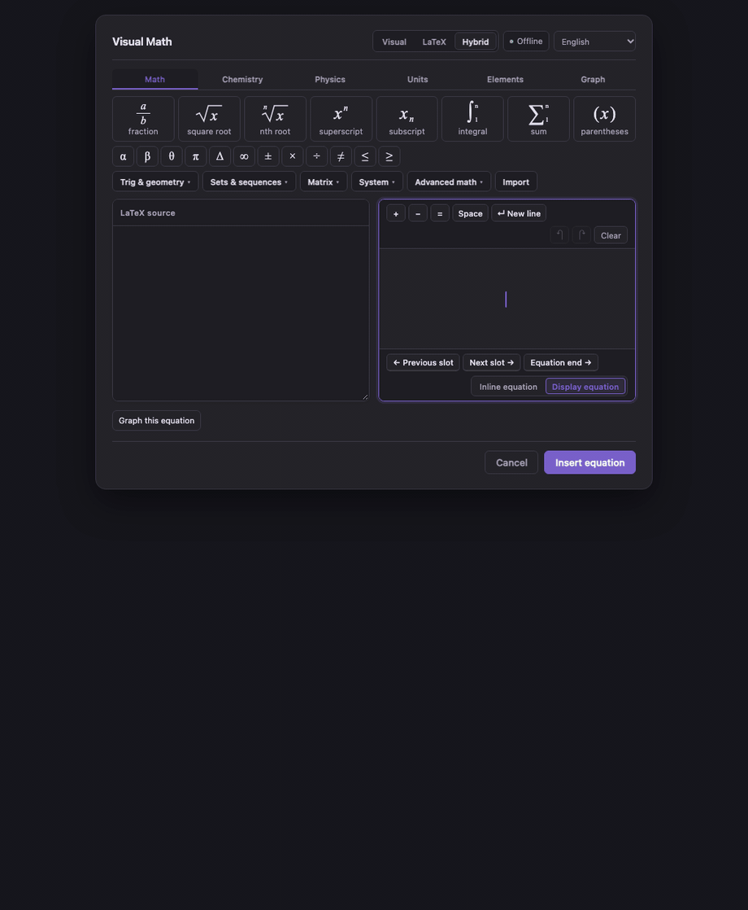
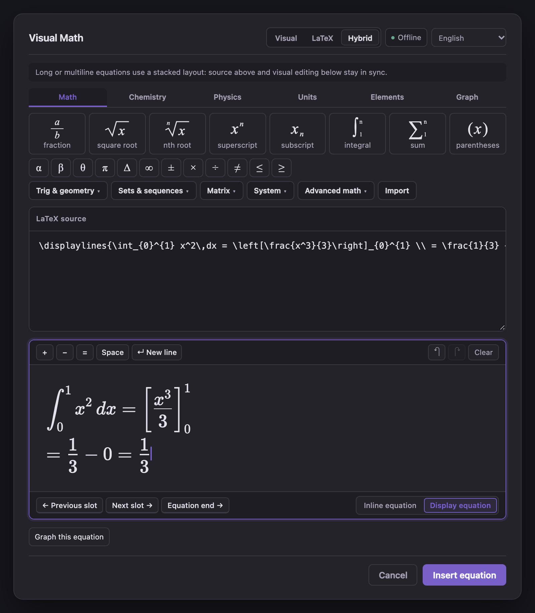
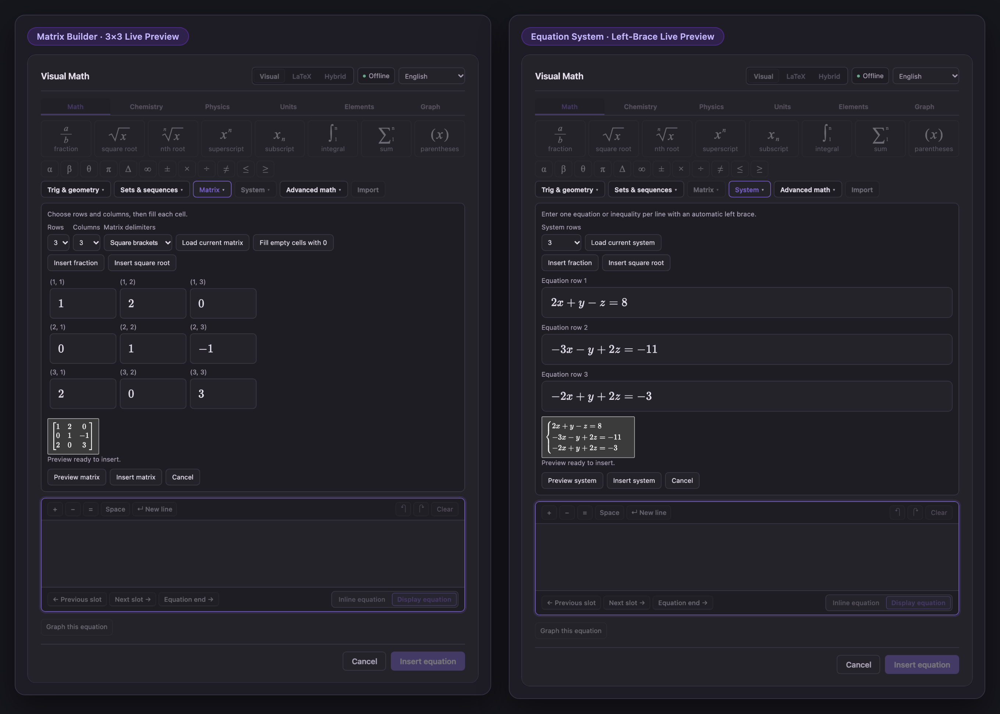
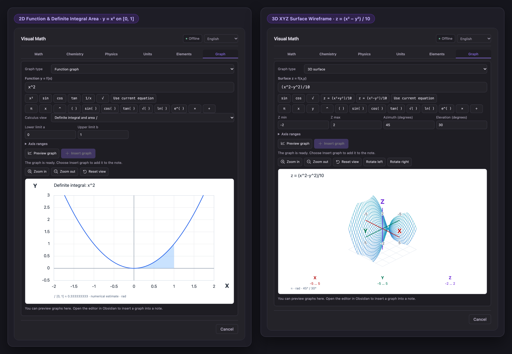
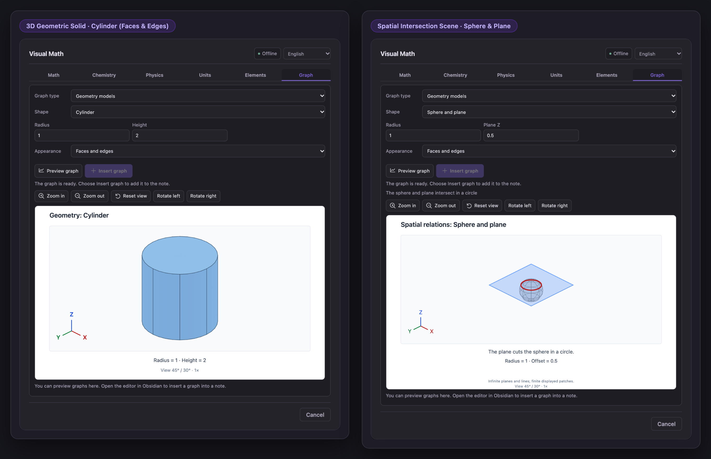
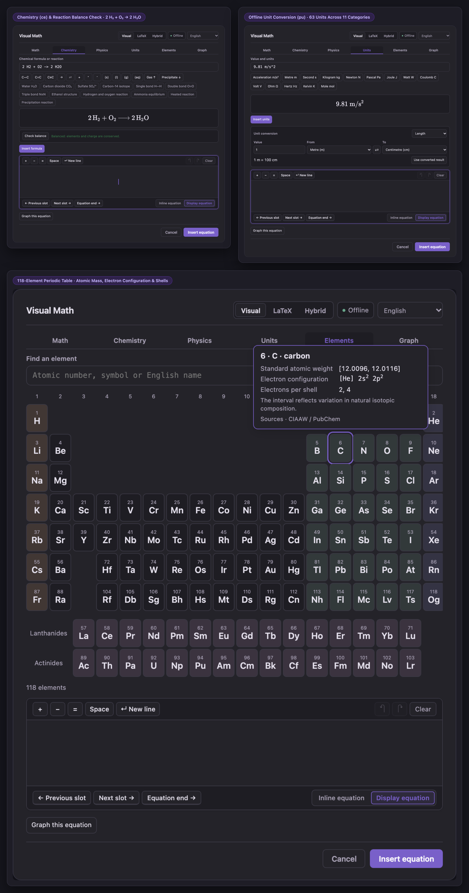

# Visual Math for Obsidian

[English](README.md) · **简体中文** · [Español](README.es.md)

**[在 Obsidian 社区商店安装](https://community.obsidian.md/plugins/visual-math-editor)** · **[官方网站](https://oranipost.github.io/visual-math/)** · **[YouTube 教程频道](https://www.youtube.com/@VisualMathForObsidian)** · **[下载 1.1.0 安装包 ZIP](https://github.com/oranipost/visual-math-editor/releases/download/1.1.0/visual-math-editor-1.1.0.zip)** · **[版本发布说明](https://github.com/oranipost/visual-math-editor/releases/tag/1.1.0)**

## 简介

我做 **Visual Math**，是为了让在 Obsidian 里写数学、化学和物理笔记更省力，不用每次都纯手敲生硬的 LaTeX 代码。

在笔记里打开编辑器后，你可以直接点分数、根号、积分、求和、矩阵或方程组，直接在方框里填空。如果你已经熟悉 LaTeX，可以切到 **LaTeX** 或 **Hybrid** 模式，左边改源码、右边看公式。需要写多行推导时，按 `↵ 换行`（`Shift+Enter`）就能在同一个公式块里换行。

所有公式都保存为标准的 `$…$` 或 `$$…$$` Markdown，内置字体、单位换算表和绘图工具全部在本地离线运行。

- **官方网站与功能指南**：[oranipost.github.io/visual-math](https://oranipost.github.io/visual-math/)
- **视频演示与教程**：[@VisualMathForObsidian YouTube 频道](https://www.youtube.com/@VisualMathForObsidian)



---

## 主要功能

- **Visual、LaTeX 与 Hybrid 三种模式**：可以用方框填空、直接写 TeX 源码，或者左右对照同时改。支持框内多行公式（`↵ 换行`）、撤销/重做历史，以及粘贴单条 LaTeX 公式导入。
- **矩阵、方程组、集合与微积分记号**：支持 `1×1` 到 `6×6` 矩阵、带左大括号的 `2–6` 行方程组、19 个集合与数列符号、三角与几何记号，以及 9 个微积分和向量模板。
- **函数、极坐标、三维曲面与复平面图像**：在公式正下方绘制 `y = f(x)`（含一阶/二阶数值导数与定积分阴影）、极坐标曲线 `r = f(θ)`、三维曲面 `z = f(x, y)` 和复平面 `Re / Im` 点图。
- **三维几何模型与空间关系**：可旋转缩放 7 种基础几何体（球体、圆柱、圆锥、正棱锥、正棱柱、长方体、平面片）和 3 种空间相交场景（两平面、直线与平面、球体与平面）。
- **化学、物理、单位换算与元素周期表**：输入化学反应式（`\ce`）并检查配平、插入常用物理公式、在 11 类 63 种单位间离线换算（`\pu`），并随时查询 118 号元素周期表。
- **本地离线与三语界面**：无需联网或注册账号，支持 **简体中文**、**English** 和 **Español**。

---

## 快速上手

1. **打开编辑器**：把光标放在笔记正文里，点击右上角或左侧工具栏的 **∑**（或在命令面板运行 `Visual Math: 插入或编辑公式`）。
2. **填入公式结构**：在 **Visual** 模式下点 **分数**，输入 `3`，按 `Tab` 跳到分母输入 `4`。需要展开更多工具时，点击下方的胶囊栏（`三角函数与几何符号`、`集合与数列`、`矩阵`、`方程组`、`高等数学模板`、`导入公式`）。
3. **保存或画图**：在编辑卡右下角选 **行内公式**（`$…$`）或 **独立一行**（`$$…$$`），点击 **插入公式**（`Ctrl/Cmd + Enter`）；或者点击 **绘制此公式** 在下方直接画出图像。

---

## 安装方式

### 从 Obsidian 社区插件市场安装

1. 打开 **[Obsidian 社区插件目录中的 Visual Math](https://community.obsidian.md/plugins/visual-math-editor)**，点击 **Add to Obsidian**。
2. 在 Obsidian 中点击 **Install（安装）**，随后点击 **Enable（启用）**。
3. 打开任意 Markdown 笔记，点击 **∑** 即可使用。

### 手动安装 ZIP（1.1.0 桌面正式版）

下载已编译好的 **[visual-math-editor-1.1.0.zip](https://github.com/oranipost/visual-math-editor/releases/download/1.1.0/visual-math-editor-1.1.0.zip)**（请不要下载 GitHub 自动生成的 *Source code* 源码压缩包）：

1. 解压并将其中的 `visual-math-editor` 文件夹放入笔记库的 `<你的笔记库>/.obsidian/plugins/` 下。
2. 确认 `main.js`、`manifest.json`、`styles.css` 与许可证文件直接位于 `.obsidian/plugins/visual-math-editor/` 内。
3. 重启 Obsidian，在 **设置 → 第三方插件** 中启用 **Visual Math**。

详细安装与更新步骤请看 [安装与更新说明](docs/INSTALLATION.md#简体中文)。

---

## 界面截图 (v1.1.0)

### Hybrid 模式、框内多行公式与紧凑工具栏


### 可视化矩阵与左大括号方程组


### 2D 函数定积分阴影与 3D XYZ 曲面


### 3D 几何立体与空间相交场景


### 化学反应配平、离线单位换算与元素周期表


---

<details>
<summary><strong>技术范围、容量边界与本地构建说明（点击展开）</strong></summary>

### 范围与边界

- **专注记号排版与数值绘图**：Visual Math 用于排版数学/科学记号、绘制有界数值图像与几何教学图形，不提供符号方程求解、矩阵运算求值、集合自动排序去重或几何定理证明。
- **单条公式导入上限**：支持粘贴裸 LaTeX 或带一层外分隔符（`$…$`、`$$…$$`、`\(...\)`、`\[...\]`）的单条公式，单次最长 **8,192 字符**。其中 **4,096 字符**以内支持实时可视化预览；4,097 至 8,192 字符的有效长公式完整保留源码，切换至 LaTeX 或 Hybrid 模式编辑与保存，不截断原文。
- **矩阵与方程组**：矩阵支持 `1–6` 行/列，方程组支持 `2–6` 行单列左大括号（`cases`）。空格可点击“空白单元格填0”，调整行列数时在当前会话内保留隐藏单元格。
- **图像与几何**：
  - 显式函数 `y = f(x)`（最长 500 字符）、极坐标 `r = f(θ)`（跨度不超过 `100π`）、有限连续区间上的一阶/二阶数值导数与定积分、三维网格曲面 `z = f(x, y)`，以及最多 20 个复数点（`a + bi`，合计 1,000 字符）。
  - 保存到笔记后，公式区块（`$…$` / `$$…$$`）与图像区块（`vme-plot`）各自独立；可用图像上的 **编辑图像** 或 **保存视野** 单独更新图像。
- **科学工具说明**：化学（`\ce{…}`）与单位（`\pu{…}`）导出到 Obsidian 外部时需要宿主环境支持 `mhchem`。离线换算基于固定的 Convert 8.0.2 常数，元素数据参考 CIAAW 与 NIST 标准。
- **兼容性**：要求桌面版 **Obsidian 1.14.4 或更新版本**。测试与发行核验记录见 [TEST-REPORT.md](TEST-REPORT.md) 与 [CHANGELOG.md](CHANGELOG.md)。

### 从源码构建

需要 Node.js 22 或 24：

```sh
npm ci
npm run check
npm run package
```

本地组件开发预览（仅监听本机 `127.0.0.1:8471`）：

```sh
npm run preview
```

参见 [CONTRIBUTING.md](CONTRIBUTING.md)、[RELEASING.md](RELEASING.md)、[LANGUAGE-SUPPORT.md](LANGUAGE-SUPPORT.md) 与 [third-party-sources/README.md](third-party-sources/README.md)。

</details>

---

## 隐私、支持与开源许可

- **离线与隐私**：无遥测、不请求远程字体或 CDN、不后台监控剪贴板（仅在你主动复制、剪切或粘贴时读取）。详见 [SECURITY.md](SECURITY.md)。
- **作者与联系**：由 [Oliver / oranipost](https://github.com/oranipost) 开发（邮箱：[oranipost@outlook.com](mailto:oranipost@outlook.com)）。问题反馈与建议请提交至 [GitHub Issues](https://github.com/oranipost/visual-math-editor/issues)。
- **许可证**：自 0.7.0 起，项目代码采用 [GNU GPL v3.0 only 加 Obsidian 链接例外](LICENSING.md)（Copyright © 2026 Dongfang Wang；`≤ 0.6.5` 代码保留原 MIT 授权）。内置的 MathLive、Convert、KaTeX 字体（MIT）与 mhchem（Apache 2.0）声明见 [THIRD-PARTY-NOTICES.md](THIRD-PARTY-NOTICES.md)。你自己的笔记与公式不受 GPL 约束。
